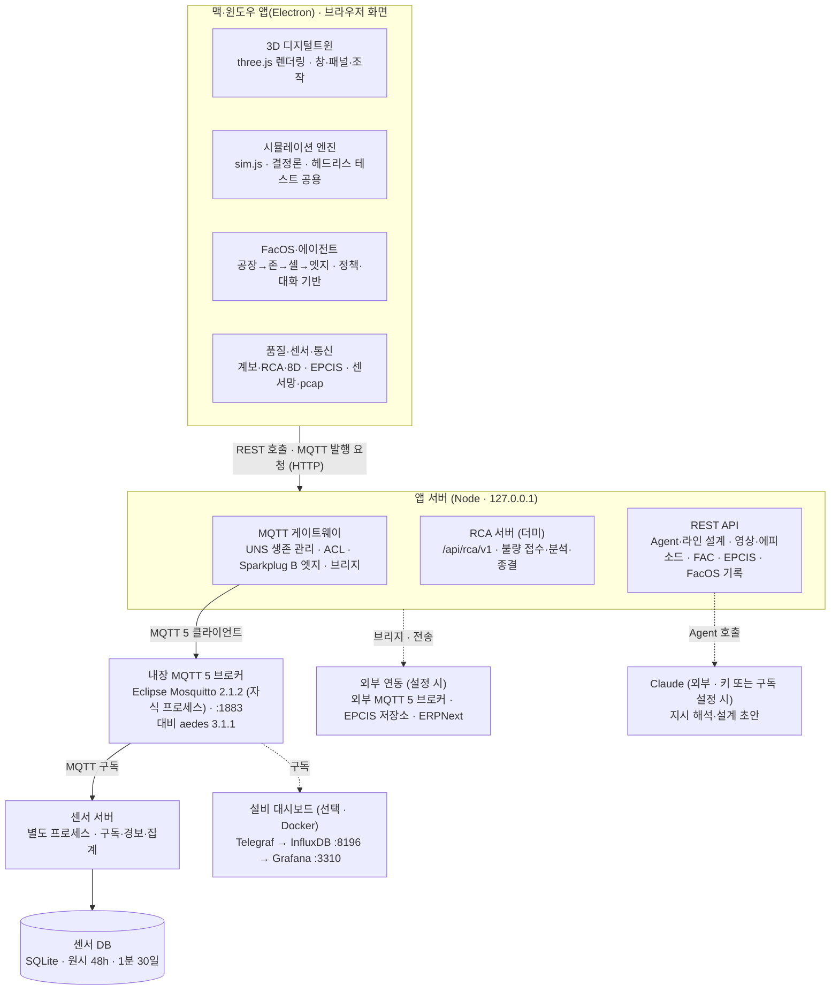
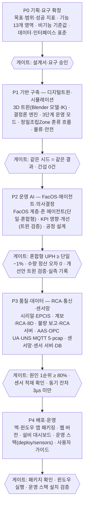

# 피지컬AI 실증 메타팩토리 정밀조립Zone 시뮬레이터 (Jin-3D) 개발 설계서

프로그램 버전 1.1.0 · 작성일 2026-11-17 · 패키지 `jin-3d` · 앱 이름 Jin-3D

레거시 → 자동화 → 피지컬AI 자율공장 3단계를 정밀조립Zone 하나의 디지털트윈에서 비교·운영하는 시뮬레이터를, 기획부터 운영까지 같은 기준으로 개발하기 위해 확정해야 할 요구사항·설계·운영 기준을 정리한 문서입니다. 상위 프로젝트 meta-factory(4 Zone) 설계서의 구성을 따르되, 이 저장소에 실제로 있는 기능과 값만 적었습니다.

관련 문서: 사용 방법은 [USER_GUIDE.md](USER_GUIDE.md), AAS 스키마 기준은 [AAS_SCHEMA.md](AAS_SCHEMA.md), KPI 영향 분석 결과는 [KPI_IMPACT_REPORT.md](KPI_IMPACT_REPORT.md), 기능별 상세는 저장소 `README.md`.

## 1. 프로젝트 개요

이 프로젝트는 정밀조립Zone(도어트림·e-axle 혼류, 셀 6개)과 공용 물류(입고·창고·출하)를 가진 가상 공장을 3D 디지털트윈으로 만들고, 같은 공장을 레거시·자동화·피지컬AI 3단계로 운영해 효과를 수치로 비교하는 실증 플랫폼입니다. 유연생산·적응가공·정밀검사 Zone은 이 시뮬레이터에 없습니다.

**목적**

- 피지컬AI(휴머노이드·AMMR·VLA 로봇·자율 에이전트) 도입 효과를 UPH·OEE·WIP·전력·불량으로 정량 비교한다.
- 공장 운영 소프트웨어(FacOS) 계층 — 공장 → 존 → 셀 → 엣지 — 의 동작을 실제 표준 데이터(AAS·OPC UA·MQTT·UNS·Sparkplug B·EPCIS)로 시연한다.
- 데이터·AI 실증 산출물(학습 에피소드, RCA 데이터셋, 센서 시계열, 패킷 덤프)을 외부 도구에서 바로 쓸 수 있게 제공한다.

**범위**

| 구분 | 포함 | 제외 |
| --- | --- | --- |
| 공장 | 정밀조립Zone(부품분류 · 도어트림 조립·체결 · e-axle 조립·체결 · 검사·포장), 서열 키팅, 구분 적재장, 입고·창고(미니로드 AS/RS)·출하, 정비실, 충전, 보안·CCTV·Private 5G·순찰 드론·사족보행 | 다른 Zone(유연생산·적응가공·정밀검사), 실제 설비 제어(PLC 쓰기) |
| 운영 | 3단계 운영 모드, 자율 에이전트(단일·혼합형 다중), FacOS 계층, 8D·RCA, KPI 개선 의사결정 | 실제 ERP·MES 운영 데이터 연동(ERPNext 연동은 선택 기능이며 가짜 서버로만 시험) |
| 데이터 | AAS·OPC UA PubSub·MQTT UNS·Sparkplug B, EPCIS 2.0, 센서망, pcap, RCA 데이터셋 | 영구 운영 DB(센서 DB·EPCIS·FacOS 기록 파일 외) |
| 배포 | 맥 앱·윈도우 앱(Electron), 브라우저 + 로컬 서버, 웹 버전(GitHub Pages), 운영 배포 참고 구성(docker compose) | 클라우드 상용 서비스 |

**이해관계자**

| 이해관계자 | 관심사 | 주요 화면·산출물 |
| --- | --- | --- |
| 사업 책임자(발주처·기관) | 단계별 성과 비교, 실증 성과지표 | 3단계 8시간 비교(진화 컨셉), KPI 영향·개선 |
| 공장 운영·생산 관리자 | Zone 상태, 병목, 의사결정 | FACOS 패널, Zone 대시보드, 공정 설계 |
| 품질 담당 | 불량 원인, 8D, 보고 체계 | 품질 추적, RCA 서버, 보고·통신 |
| 데이터·AI 엔지니어 | 학습·분석 데이터 | VLA·AIOS 데이터셋, RCA 노트북, 센서 DB |
| IT·인프라 담당 | 통신·서버·보안 | 데이터 연동, UNS 토픽 트리, pcap, 센서 서버, 설비 대시보드, 운영 배포 구성 |

**성공 지표**

| 지표 | 목표 |
| --- | --- |
| 3단계 비교 재현성 | 같은 시드·라인이면 같은 결과 (0.1초 고정 간격 결정론적 시뮬레이션) |
| 회귀 테스트 | `npm test` 전체 통과 (현재 테스트 파일 53개 + import map 점검) |
| 물리 간섭 | `npm run check:interference` 3개 모드 겹침 0건 |
| AI 원인 분석 | 원인 셀 1순위 적중 80% 이상 · 3순위 안 95% 이상 (시뮬레이션 정답 기준, `tests/trace.mjs`) |
| 시간 동기 | 유선 센서 기준 시계 대비 3µs 미만 · LoRaWAN 20ms 미만 (`tests/sensors.mjs`) |
| 배포 | 앱 1회 실행으로 앱 서버·MQTT 브로커·센서 서버 자동 구동 |

## 2. 기능 요구사항

기능은 13개 영역으로 나누고, 영역마다 헤드리스 테스트로 확인할 수 있는 완료 기준을 미리 정합니다.

| # | 기능 영역 | 핵심 기능 | 완료 기준 (검증) |
| --- | --- | --- | --- |
| F1 | 3D 디지털트윈 | 건물·셀·로봇·설비 모델(Blender GLB), 로봇 IK 동작, 클릭 상세, 라벨, 화면 보간, 구간별 성능 표시 | 이동체 형상 간섭 점검 겹침 0건, 화면 실행 점검 콘솔 오류 없음 (`check:interference` · `smoke` · `tests/blender.mjs`) |
| F2 | 공장 시뮬레이션 | 셀 가동·고장·정비, AMR(16대)·AGV·지게차 이동, 재고, 에너지, 배터리 | 같은 시드 = 같은 결과, 보간을 켜도 출하량·UPH·OEE 동일 (`tests/stepinterp.mjs` · `battery.mjs` · `paths.mjs`) |
| F3 | 3단계 운영 모드 | 레거시(작업자·사후보전) · 자동화(로봇·MES) · 피지컬AI(휴머노이드·자율) 전환, 3단계 8시간 비교(Worker) | 비교 계산 = 0.1초 간격 직접 운전 결과 (`tests/compare.mjs`) |
| F4 | 정밀조립Zone 운영 | 도어트림·e-axle 혼류(1:1 · 2:1 · 1:2 · 단일), 분류·포장 게이트, 서열 키팅(SPS), 실제 작업 시간, AMR 셀 밖 대기 | 셀 안 AMR은 늘 한 대, 키트 구성·제품 쪽 로봇만 작업 (`tests/cellentry.mjs` · `sps.mjs`) |
| F5 | 공정 설계 | 셀 레시피 편집, 사용자 라인(공정 유형 9종 · 로봇 6종), 자연어·파일 첨부 설계 초안, 예상 병목·이론 UPH | 제약 위반 자동 보정(`normalizeLine`), 확인 후 적용 시 새 라인으로 재시작 |
| F6 | 운영 에이전트 (FacOS) | 공장 오케스트레이터 · Manufacturing Agent(존) · 셀 OCS · 엣지 스킬, A2A 메시지·가드레일, 오더·수량 정산, 단일·혼합형 다중 에이전트 | 혼합형 UPH ≥ 단일 × 0.99, 수량 정산 오차 0, 이상 판단 ≤ 10초 (`tests/multiagent.mjs` · `factoryos.mjs` · `fosops.mjs`) |
| F7 | 품질·RCA·8D | WIP ID → 제품 시리얼·EPC, QR 마킹·판독, 출하 SSCC, 출하 전 샘플 재검·봉쇄·처분, 계보 베이즈 원인 분석, 8D CAPA, 운영 정책 반영 | 원인 셀 1순위 80% 이상, 8D 종결까지 진행, 시리얼 재사용 없음 (`tests/trace.mjs` · `serial.mjs` · `codexfix.mjs`) |
| F8 | 불량 보고 통신 | 검사셀 엣지 → 메인 서버(MQTT) → RCA 서버(HTTP) → 결과·조치·종결, 품질 통신 pcap | 사례마다 5단계 메시지, 같은 실행·사례 = 같은 티켓 (`tests/qcomm.mjs`) |
| F9 | 데이터 연동 | AAS 자산 모델, OPC UA PubSub JSON over MQTT, UNS(ISA-95)·Sparkplug B·ACL, 내장 MQTT 5 브로커, EPCIS 2.0 저장소, AASX·CSV·AML 저장, 전체·개별 pcap, ERPNext 연동(선택) | Wireshark MQTT v5 해석·체크섬 정상, UNS 명령 4단, GS1 EPCIS 스키마 통과 (`tests/pcap.mjs` · `uns.mjs` · `mosquitto.mjs` · `epcis.mjs` · `aasbasyx.mjs` · `erpnext.mjs`) |
| F10 | 센서망·설비 대시보드 | 센서 20종 46개(정밀조립Zone 셀 6개 + 환경 노드 + 공용 설비), 셀 엣지 → 게이트웨이 → 존 서버 → 중앙, PTP 동기, 센서 서버·DB, Zone 대시보드, Telegraf → InfluxDB → Grafana(선택) | 전 셀 배치, 실제 브로커 → 센서 서버 → SQLite 적재, 시간 정렬 조회 (`tests/sensors.mjs` · `zonekpi.mjs` · `monitor.mjs`) |
| F11 | KPI 영향·개선 | 원인별 OEE 손실 분해, 개선 제안 → 디지털트윈 검증 → 적용·실측·되돌리기(FacOS 결정 경로) | 손실 합 + OEE = 100%, 트윈 검증 결과와 실측 기록 (`tests/impact.mjs`) |
| F12 | 물류·안전·보안 | 입고·창고·출하, FAC 업무 기록, 현장 이벤트(누유·연기·사람 진입), 우선순위 P1~P5, 비상정지·보호정지, CCTV·Private 5G·드론·사족보행, 다중 계층 보안, 현장 로봇 업링크 | 이벤트 150초 안 해결, FAC 재고 = 시뮬레이션 재고 (`tests/hazard.mjs` · `priority.mjs` · `logistics.mjs` · `fac.mjs` · `net5g.mjs` · `security.mjs` · `fieldtx.mjs`) |
| F13 | AI 학습 데이터·안내 | VLA 에피소드, AIOS 운영 데이터셋, RCA 데이터셋(EPCIS·ISA-95·특징 표), DoWhy·PyRCA 노트북, 토리 안내 아바타(한국어·영어) | 에피소드 보관 한도 준수 (`tests/vla.mjs` · `episodekeep.mjs`) |

## 3. 비기능 요구사항

비기능 요구는 가능한 한 수치로 정하고, 측정 방법까지 함께 확정합니다.

| 분류 | 요구 | 기준값 | 측정 방법 |
| --- | --- | --- | --- |
| 성능 | 3D 화면 프레임 | 5개 장면의 fps·CPU 시간·그리기 호출 수를 기록하고 변경 전후 비교 (README 측정값: 레거시 60.8 · 자동화 30.5 · 피지컬AI 20.9fps, 1600×960) | `npm run perf` → `outputs/perf/` |
| 재현성 | 결정론 | 같은 모드·시드·라인 = 같은 결과. 시뮬레이션은 0.1초 고정 간격(`SIM_DT`)으로만 진행 | `tests/stepinterp.mjs` · `tests/compare.mjs` |
| 재현성 | 난수 분리 | AIOS 학습·보안 시연·사용자 현장 이벤트·센서 측정값은 생산 흐름 난수와 따로 뽑음 | `tests/stepinterp.mjs` · `tests/sensors.mjs` |
| 재현성 | 통계 신뢰도 | 에이전트 구조 비교는 자동화 시드 40개 · 피지컬AI 시드 12개 평균 | `tests/multiagent.mjs` |
| 시간 동기 | 기준 시계 단일화 | 모든 타임스탬프는 DataHub 기준 시계(ISO 8601 UTC · µs). 유선 PTP 잔차 3µs 미만, LoRaWAN 20ms 미만 | `tests/sensors.mjs` |
| 가용성 | 서버 없는 환경 | 웹 버전은 서버 없이 3D 운영·단계 전환·데이터 수집·파일 저장이 동작 (`window.JIN3D_NO_SERVER`) | 웹 버전 점검 |
| 가용성 | 포트 충돌 | 앱의 내장 서버(47615)·MQTT 브로커(1883)는 포트가 막히면 빈 포트로 대체. 앱이 띄우는 센서 서버는 빈 포트 사용 | `tests/mosquitto.mjs`, 상태 API |
| 가용성 | 브로커 대비 | Mosquitto 실행 파일이 없거나 시작에 실패하면 aedes(MQTT 3.1.1)로 대비 | `tests/mosquitto.mjs` |
| 정확성 | 물리 간섭 | 지상 이동체 실제 3D 형상 ↔ 셀 로봇·설비·기둥·상자 겹침 0건 (평면 다각형 SAT + 높이 겹침, 0.5초마다) | `npm run check:interference` |
| 확장성 | 정의 데이터 분리 | 셀·경로·혼류·작업 시간(`line.js`), Zone 정의(`zonedefs.js` — 단일 Zone 얇은 판), 센서 배치(`sensors.js`)를 데이터로 분리 | 설계 검토 |
| 보안 | 비밀 정보 | API 키·연동 키는 OS 보안 저장소(safeStorage) 암호문으로만 저장, 응답에는 설정 여부만 | `tests/finalfix.mjs` |
| 보안 | 로컬 서버 | 이 앱 화면이 보낸 요청만 받음(루프백 Host · Origin · Sec-Fetch-Site) | `tests/finalfix.mjs` · `tests/reviewfix.mjs` |
| 사용성 | 언어·문구 | 화면 문구·주석 한국어, 수치에 단위 표기 | 화면 점검 |
| 유지보수 | 모듈 분리 | 시뮬레이션(DOM 없음) ↔ 화면 ↔ 서버 분리, 브라우저·서버 공용 모듈(`line.js` · `agentcore.js` · `rcacore.js` · `epcis.js`) 사용 | 모듈 의존 검토 |

## 4. 시스템 아키텍처

시뮬레이션·3D·에이전트는 화면(맥·윈도우 앱, 브라우저)에서 돌고, 앱 서버가 API·브로커·RCA·EPCIS·FacOS 기록을 맡으며, 센서 저장은 별도 프로세스와 별도 DB가 맡습니다.

앱 하나를 실행하면 앱 서버(게이트웨이·RCA·EPCIS·FacOS 기록 포함), Mosquitto 브로커, 센서 서버 프로세스가 함께 뜬다. 웹 버전은 맨 윗줄(화면)만 동작하며, 대화 기반 Agent는 사용자가 넣은 API 키로 브라우저가 Claude API를 직접 호출한다. 설비 대시보드는 사용자가 켤 때만 Docker 컨테이너 3개로 뜬다.

**코드 구성 (직접 센 값)**

| 폴더 | 파일 수 | 내용 |
| --- | --- | --- |
| `js/` | 74개 (23,209줄) | 시뮬레이션·3D·에이전트·데이터·화면 모듈 (ES 모듈) |
| `server/` + `server.mjs` | 21개 (2,698줄) + 진입점 | 앱 서버·게이트웨이·브로커 기동·RCA·센서·EPCIS·ERPNext·FacOS 기록·대시보드 |
| `electron/` | 2개 | 앱 셸(`main.mjs` · `preload.cjs`) |
| `tests/` | `.mjs` 54개 (3,942줄) + `ui-scroll.cjs` | 헤드리스 테스트 · UI 스크롤 점검 |
| `tools/` | 9개 | 간섭 점검 · smoke · 성능 측정 · import map 갱신 · Grafana JSON 생성 · 토리 음성 생성 · Blender 원형 수집 · 사용자 가이드 그림 찍기(`guide-shots.cjs`) · 사용자 가이드 PDF(`guide-pdf.cjs`) |
| `deploy/sensors/` · `monitoring/` · `analysis/rca/` | — | 운영 배포 참고 구성 · 설비 대시보드 구성 · DoWhy·PyRCA 노트북 |

## 5. 데이터 설계

모든 데이터는 하나의 기준 시계(시뮬레이션 0초 = 시작일 08:00 현지, ISO 8601 UTC·µs)를 쓰고, 영역마다 산업 표준 형식을 따릅니다.

| 데이터 영역 | 내용 | 표준·형식 | 저장 위치 | 보존 |
| --- | --- | --- | --- | --- |
| 자산·텔레메트리 | 셀·로봇·AMR·설비·5G 기지국 상태, 명령 | AAS(IDTA Part 1 v3.1 · 저장 옵션 v3.0) 서브모델, OPC UA PubSub JSON, MQTT | 브로커 발행, AASX·JSON·XML·RDF·CSV·AML 파일 | 화면 수집 버퍼(최근 6,000회차) |
| UNS | FacOS 상태·오더·결정·A2A, 셀 OCS, 명령 4단, 설비 요약, Zone KPI, 현장 로봇 업링크 | ISA-95 통합 네임스페이스, Sparkplug B, MQTT 5 속성 | 브로커 발행(상태는 retain · 바뀔 때만) | 브로커 |
| FacOS 기록 | 실행 시작·계획 버전·오더·결정·A2A | 실행별 JSONL | 데이터 폴더 `facos/<run>.jsonl` | 최근 50개 실행 (`FACOS_KEEP_RUNS`) |
| 제품 계보 | WIP ID·시리얼·EPC, 셀 통과, 설비·환경·센서 값, 검사 | ISA-95 Material/Equipment Actual, GS1 AI | 메모리(최근 3,000개), RCA zip | 실행 중 |
| EPCIS | 발행·적재·팔레트 묶음·출하·보류·해제·재작업·격리·폐기 이벤트 | GS1 EPCIS 2.0 / CBV 2.0 JSON-LD | 데이터 폴더 `epcis/events.jsonl` (웹 버전은 브라우저 메모리) | 최근 20만 건 · 다시 켜도 남음 |
| 품질·8D | 불량 사례, 원인 분석, CAPA 단계, 정책 | 8D, FMEA 발생도·AP | 메모리, RCA zip | 실행 중 |
| 불량 보고 | 리포트·티켓·분석 결과·종결 | CloudEvents 1.0, `metafactory/quality-defect-report/1.0` | RCA 서버 메모리 | 앱 실행 중 |
| 센서 | 측정값·동기 잔차·계층 시각·1분 집계·경보 | `metafactory/sensor-batch/1.0` · `metafactory/sensor-birth/1.0` | 데이터 폴더 `sensors/sensors.db` (SQLite · node:sqlite) | 원시 48시간, 1분 집계 30일 |
| 설비 대시보드 | 설비 건강도·RUL, 센서, Zone OEE·품질 표본, 운영 이벤트 | InfluxDB 2.7 시계열 | Docker 볼륨 `jin3d-mon_influx-data` | 원시 7일, 1분 집계 90일 |
| 업무 기록(FAC) | 구매오더·재고 전표·정비요청·설비 | 이벤트 스트림(seq) | 앱 서버 메모리 | 최근 20,000건 |
| ERPNext 연동 | FAC 이벤트 → 전표 대기열, 연동 설정 | JSONL 대기열, 암호화 설정 파일 | 데이터 폴더 `erpnext/queue.jsonl` · `erpnext/config.json` | 전송까지 |
| AI 학습 | VLA 에피소드(영상·관절), AIOS 운영 데이터 | 에피소드 zip, MP4 | 데이터 폴더 | 로봇마다 최근 500개 · 전체 3GB (`JIN3D_EPISODE_KEEP` · `JIN3D_EPISODE_MAX_MB`) |
| 영상 | CCTV·로봇 카메라 녹화 | WebM·MP4 | 데이터 폴더 | WebM 576구간 · MP4 144구간 · CCTV 4GB · 로봇 카메라 8GB (`JIN3D_CCTV_*` · `JIN3D_ROBOTCAM_*` · `JIN3D_MP4_KEEP`) |
| 설정 | 적용한 라인, AAS 버전, 패널 접힘 상태, 웹 버전 API 키(선택) | localStorage `jin3d.*` | 브라우저 | 영구 |

**설계 원칙**

- **한 시계:** DataHub 기준 시계를 PTP Grandmaster로 보고, 센서·계보·품질 통신·pcap이 모두 같은 축을 쓴다. 같은 순간 조회는 센서 서버 `/align`.
- **정답 라벨 분리:** 시뮬레이션 정답(불량이 생긴 셀)은 학습 특징 표(`features.csv`의 `label_root_cause_station`)에만 둔다.
- **토픽 체계:** 평면 토픽 `metafactory/{영역}/v1/{존}/{셀}`과 UNS 트리 `camtic/metafactory/main/{셀}/…`를 병행한다(UNS 토픽 뿌리는 상위 공장과 같음). 크기가 큰 문서는 HTTP REST, 알림·실시간 값은 MQTT.
- **식별자:** AAS id 네임스페이스는 `https://camtic.or.kr/aas/jin3d/…`, OPC UA 토픽의 발행자는 `jin3d/MetaFactory`, Zone 열쇠는 `main` 하나(공용 설비 센서는 `fac`).
- **스키마 버전:** 메시지·파일에 `spec`/`schema` 버전을 넣는다.

## 6. 인터페이스 설계

외부에 공개하는 인터페이스는 REST(문서·조회)와 MQTT(실시간·알림) 두 가지입니다.

**REST API**

| 서버 | 경로 | 용도 |
| --- | --- | --- |
| 앱 서버 | `/api/status` | 서버 기능·Agent 연결 상태·데이터 폴더·ffmpeg |
| 앱 서버 | `/api/agent`, `/api/line` | Agent(Claude) 대화 지시 해석, 자연어 라인 설계 |
| 앱 서버 | `/api/mqtt/status`, `/api/mqtt/publish` | 내장 브로커 상태·발행 |
| 앱 서버 | `/api/uns/bridge`, `/api/uns/acl/password`, `/api/uns/commands/take` | 외부 MQTT 5 브로커 브리지 설정, UNS 계정 비밀번호 보기, 외부 명령 요청 대기열 |
| 앱 서버 | `/api/facos/v1/status · runs · events · decisions · orders · plans · export` | FacOS 기록 조회 |
| 앱 서버 | `/api/cctv`, `/api/robotcam`, `/api/convert`, `/api/clip-mp4`, `/api/frames-mp4`, `/videos/…` | 영상 저장·변환·제공 |
| 앱 서버 | `/api/episodes`, `/api/aios` | VLA 에피소드, AIOS 운영 데이터셋 |
| 앱 서버 | `/api/fac/status · events · po · moves · stock · mr · equipment · orderpoints · master`, `POST /api/fac/push` | FAC 업무 기록 (외부 조회는 읽기 전용) |
| 앱 서버 | `/api/epcis/v1/capture · events · trace · shipment · status · serial-base` | EPCIS 2.0 캡처·질의·추적 사슬·리콜 범위 |
| 앱 서버 | `/api/erpnext/v1/…`, `/api/monitor/v1/…` | ERPNext 연동 설정·상태, 설비 대시보드 켜기·끄기 |
| RCA 서버 | `POST /api/rca/v1/reports` → 202, `GET …/reports`, `POST …/{티켓}/close` | 불량 리포트 접수·분석·종결 (앱 서버 안 · 단독 실행 `npm run rca-server` 127.0.0.1:8775) |
| 센서 서버 | `/api/sensors/v1/status · sensors · latest · readings · agg · alarms · align · latency · export.csv` | 센서 조회·집계·경보·시간 정렬 (앱 서버가 중계 · 단독 실행 `npm run sensor-server` 127.0.0.1:8793) |

**MQTT 토픽**

| 토픽 | 발행 → 구독 | 내용 |
| --- | --- | --- |
| `opcua/json/data/jin3d/MetaFactory/<자산>` · `…/Events` · `…/Commands` | 자산(셀·로봇·AMR·CCTV) ↔ FACOS·DataHub | OPC UA PubSub ua-data(텔레메트리·영상) · 이벤트 · 상위 명령 |
| `opcua/json/metadata/jin3d/MetaFactory/<자산>` · `aas/jin3d/environment` | 자산 → 구독자 (retain) | DataSetMetaData · AAS 구조 |
| `camtic/metafactory/main/{셀}/…` · `…/_facos/state` · `…/_zone/…` · `…/_field/{자산}/…` | 앱 → 구독자 | UNS 트리: FacOS 상태·오더·결정·A2A, 셀 OCS, 명령 4단(`cmd → cmd/ack → cmd/exec → cmd/done`), 현장 로봇 업링크 |
| `camtic/metafactory/main/{셀\|_zone}/cmd/request` | 외부(operator · zone-main) → 앱 | 외부 명령 요청 (Correlation ID · 응답 토픽 · 만료) |
| `metafactory/quality/v1/defect/main/{검사셀}` | 검사셀 엣지 → 메인 서버 | 불량 판정 리포트 (CloudEvents · QoS 1) |
| `metafactory/quality/v1/rca/{사례}/result` | RCA 서버 → 메인 서버 | 우선순위·원인·봉쇄·대책 |
| `metafactory/quality/v1/action/{셀}` · `…/ack/{사례}` | 메인 서버 ↔ 셀 | 봉쇄 지시·수신 확인 |
| `metafactory/sensors/v1/{main\|fac}/{셀}` · `…/birth` | 존 서버 → 센서 서버 | 1초 측정값 묶음 · 센서 메타(retain) |
| `metafactory/telemetry/v1/main/{설비}` · `metafactory/events/v1/{수준}` · `metafactory/oee/v1/main` · `metafactory/quality/v1/main` | 앱 → Telegraf | 설비 대시보드 수집 |

**인터페이스 규칙**

- 새 API·토픽은 경로에 `v1` 버전을 넣고, 호환이 깨지면 `v2`를 별도로 연다.
- 접수형 요청은 202 + 티켓, 같은 실행(runId)의 같은 사례 재전송은 같은 티켓(멱등).
- 쓰기 권한은 UNS 역할표(`server/uns-acl.mjs`)로 나눈다 — 익명 = 읽기 전용, `operator` = 명령 요청, `zone-main` = 자기 존 명령 요청, 엣지·호스트 = 자기 Sparkplug 토픽. UNS 상태 토픽은 앱만 발행한다.
- 내장 브로커는 외부 MQTT 5 브로커로 브리지할 수 있다(UNS 탭 설정 또는 `MQTT_BRIDGE_URL` · `MQTT_BRIDGE_VERSION` · `MQTT_BRIDGE_USER` · `MQTT_BRIDGE_PASSWORD`).
- FAC 쓰기 API(외부 발주·정비요청 접수)는 아직 없다.

## 7. 시뮬레이션·디지털트윈 설계 원칙

시뮬레이션 핵심은 화면 없이 도는 결정론적 엔진이고, 3D·UI는 그 상태를 그리기만 한다는 것이 최상위 원칙입니다.

1. **헤드리스 분리:** 생산 흐름·설비 상태·에이전트·품질·센서는 DOM이 없는 모듈(`sim.js` 등)에 두고, Node 테스트와 디지털트윈 검증이 같은 코드를 돌린다.
2. **결정론:** 생산 흐름은 시드 난수(`sim.rand`) 하나만 쓴다. AIOS 학습(`aios.rng`)·보안 시연(`sec.rng`)·사용자 현장 이벤트(`sim.evRand`)·센서 측정값은 별도 난수를 써서, 부가 기능을 켜도 생산 결과가 바뀌지 않는다. 단, 품질 추적의 환경 이상은 민감 공정의 불량 확률을 올리므로 그 뒤 생산 결과에 영향을 준다(설계상 의도).
3. **고정 시간 간격:** 0.1초 간격(`SIM_DT`)으로만 진행하고, 배속은 한 화면 프레임에 여러 간격을 돌리는 방식으로 만든다. 간격 사이 프레임은 화면 보간(`stepinterp.js`)으로 그리며 시뮬레이션 상태는 바꾸지 않는다.
4. **단일 Zone:** Zone 열쇠는 `main` 하나이고 `js/zonedefs.js`는 단일 Zone용 얇은 판이다. 상위 프로젝트에서 정밀검사Zone이 하던 샘플 검사는 검사·포장셀의 출하 전 샘플 재검으로 닫는다.
5. **데이터 주도 구성:** 셀 배치·경로·혼류 비율·AMR·실제 작업 시간은 `js/line.js`(`ZONE_CELLS` · `ZONE_ROUTES` · `ZONE_MIXES` · `ZONE_AMR` · `ZONE_T`), 운영 파라미터는 `js/sim.js`(`MODES` · `STATION_DEFS`), 센서 배치는 `js/sensors.js`에 두고 코드는 그것을 읽는다.
6. **실물 모델·실제 동작:** 로봇은 IK로 움직이고, 작업은 물건에 실제로 닿는 접촉 동작(로봇당 2~4점 압입·체결, 키트 부품 1개씩 가져오기)으로 표현한다. 셀 사이클은 작업 요소를 더한 실제 작업 시간이다.
7. **물리 간섭 자동 점검:** 지상 이동체의 실제 3D 형상이 셀 로봇·설비·기둥·상자와 겹치는지 0.5초마다 본다. 의도된 접촉(바닥 판 · 자기 충전 도크 · 포크 ↔ 팔레트)은 뺀다.
8. **디지털트윈 검증:** 개선안은 같은 라인·운영값·현장 이벤트를 재연한 트윈(30분 × 시드 3)에서 현재 vs 제안을 비교한 뒤 적용 여부를 묻는다.

## 8. AI·에이전트 설계

에이전트는 FacOS 계층(공장 → 존 → 셀 → 엣지)을 따르고, 명령은 위에서 아래로·상태는 아래에서 위로 흐릅니다. 결정이 필요한 일은 공장으로 올립니다. 존이 `main` 하나라 존 ↔ 존 메시지는 생기지 않습니다(계층 권한표는 그대로 둠).

| 계층 | 주체 | 책임 | 구현 형태 |
| --- | --- | --- | --- |
| 공장 | 공장 오케스트레이터(FacOS) · Agent Gateway | 오더 배정(양품 100개 단위)·종료, 결정 요청 처리(납기 위험·8D 정책 승인·운영 변경·응답 시간 초과), 계층 권한표·A2A 기록 | 규칙 기반 + 사람 결정(HITL) |
| 존 | Manufacturing Agent(정밀조립 존 오케스트레이터) · 존 에이전트 | 인시던트 처리, 정비·품질·흐름·물류 판단, 수량 정산, 납기 감시, 공장 에스컬레이션 | 단일 에이전트(판단 모듈 6개) 또는 혼합형 다중(반사 계층 + 정비·품질·흐름 제안 + 메인 조정자) |
| 셀 | 셀 OCS | 상태 7종(IDLE · READY · RUN · DONE · HOLD · RECOVER · SAFE-STOP), 명령 검증·거절 사유 | 상태머신 |
| 엣지 | 스킬 (VLA 파지·장착, 위치정합, 체결 판정, 압입, 동작 감시, 인터록 등) | 동작 실행·감시 | 시뮬레이션 모델 |

**운영 원칙**

- 운영 변경(KPI 개선안 적용·되돌림, AIOS 정책 배포·롤백, 대화 지시 중 계획 변경)은 모두 FacOS 결정을 거쳐 계획 버전 P-n을 올린 뒤 적용한다(`FactoryOS.change`).
- 상위망이 끊기면 공장행 메시지는 Edge Outbox에 쌓고, 공장 결정이 필요한 변경은 적용하지 않는다. 승인 범위 안 자율 조치는 적용 뒤 복구되면 사후 확인한다.
- 여러 문제가 겹치면 P1 화재·인명 → P2 시설·작업 안전 → P3 생산 정지 → P4 생산 차질 → P5 효율·품질 순으로 처리한다.

**LLM(Claude) 사용 원칙**

- **보조 역할만:** 운영 판단의 기본은 정책(규칙) 기반이고, LLM은 자연어 지시 해석·공정 설계 초안에만 쓴다. 키가 없어도 내장 해석기로 동작한다.
- **호출 경로:** 앱·`npm start`는 서버가 Claude API(`ANTHROPIC_API_KEY`) 또는 Claude 구독(`CLAUDE_AUTH=subscription`, `server/claude-sub.mjs`)으로 호출하고, 웹 버전은 사용자가 넣은 키로 브라우저가 직접 호출한다. 모델은 `js/agentcore.js`의 `MODEL` 한 곳에서 정한다.
- **구조화 출력 + 검증:** 응답은 구조화 출력·strict 도구로 받고, 같은 제약 코드(`normalizeLine`, 스냅샷 검증)로 다시 검사해 위반은 보정·경고한다.
- **사람 확인 후 적용:** 초안은 변경 내역·예상 지표를 보여 주고 사람이 적용을 누른다. 대화 지시는 게이트(`js/gate.js`)를 거쳐 수행·거절한다.
- **첨부 파일은 자료:** 첨부 문서·이미지 안의 문장은 지시로 따르지 않는다(프롬프트 주입 방지 — `server/line-designer.mjs` 시스템 지침).
- **자동 테스트 제외:** 외부 비용이 드는 LLM 호출은 `npm test`에서 부르지 않는다.

**분석 AI**

- 불량 원인: 계보 기반 베이즈 분해(설명 가능한 규칙 계산) + 외부 검증용 DoWhy GCM·PyRCA 노트북(`analysis/rca/`).
- 개선 제안: 손실 원인별 규칙 → 디지털트윈 검증 → 적용 후 10분 실측 → 해석(레버 효과·외란 구분).
- RCA 전담 서버는 실제 분석 엔진이 아니라 리포트에 실린 내장 분석 순위로 판정 규칙만 적용하는 자리표시 서버다.

## 9. 보안·안전 설계

로컬 데모 앱이라도 운영 환경으로 옮길 때 바뀌지 않도록, 접근 범위·비밀 정보·운영 안전을 처음부터 설계에 넣습니다.

| 영역 | 현재 설계 | 운영 전환 시 추가 |
| --- | --- | --- |
| 네트워크 노출 | 앱 서버·브로커·센서 서버·RCA 서버 모두 127.0.0.1에만 열림. 설비 대시보드(Grafana 3310 · InfluxDB 8196)도 127.0.0.1에만 게시 | 방화벽 구역 분리(OT/IT), 필요한 포트만 개방 |
| 요청 출처 | 로컬 서버는 루프백 Host · 같은 출처 Origin · Sec-Fetch-Site를 검사해 이 앱 화면의 요청만 받음(거부 403). 정적 파일은 공개 폴더만 | REST 토큰 또는 mTLS |
| 인증·권한 | MQTT는 UNS 역할별 계정·ACL(Mosquitto 비밀번호·ACL 파일 자동 생성, 권한 밖 발행은 버림). REST는 인증 없음 | MQTT TLS, DB 암호, Grafana 관리자 암호 |
| 비밀 정보 | Claude API 키는 safeStorage(맥 키체인 · 윈도우 DPAPI)로 암호화해 사용자 데이터 폴더에 저장하고 화면으로 전달하지 않음. 연동 키(EPCIS 토큰 · ERPNext 키 · 브리지 비밀번호)는 `server/secrets.mjs`로 암호문 저장. `.env`는 저장소 제외 | 비밀 관리 서비스 |
| 웹 버전 키 | 사용자가 넣은 API 키는 그 브라우저 저장소에만 둠(기억을 끄면 탭을 닫을 때 지워짐) | — |
| 데이터 내보내기 | 에피소드·AIOS·RCA 데이터 내려받기마다 보안 이벤트 기록(`sec.onExport`) | 감사 로그 보관 |
| AI 안전 | LLM 출력은 제약 검사 후 사람 승인, 첨부 내용은 지시로 취급 안 함 | 요청·응답 기록 |
| 다중 계층 보안(시연) | 주체 DID/VC·최소 권한, 명령 OTAC·구간 암호화, VLA 연합학습·ZKML 검증 배포, eVDI 반출 통제, 위협 주입 → 보안 인시던트 (`js/security.js`) | 실제 보안 제품 연동 |
| 운영 안전 | 비상정지·보호정지·감속 등 상위 명령(전송 → ACK → 실행 → 완료), 셀 OCS 명령 검증, 6축 셀 안전 펜스·라이트커튼·인터록 문 | 실제 PLC 안전 회로와는 별도 (이 시스템은 쓰기 안 함) |
| 제어 범위 | 시뮬레이터는 실제 설비에 명령을 보내지 않음 | 실제 연동 시 읽기 전용으로 시작, 쓰기는 별도 승인 경로 |

설계 원칙: 기본은 닫힌 상태(로컬·읽기 전용)에서 시작하고, 열 때마다 근거와 기록을 남긴다.

## 10. 검증·테스트 전략

기능마다 수치로 판정하는 헤드리스 테스트를 함께 만들고, 변경할 때마다 아래 5개 계층을 통과해야 배포합니다.

| 계층 | 도구 | 범위 | 통과 기준 |
| --- | --- | --- | --- |
| 1. 헤드리스 회귀 테스트 | `npm test` (테스트 파일 53개 + `tools/stamp-version.mjs --check`) | 아래 목록 | 전체 PASS |
| 2. 물리 간섭 점검 | `npm run check:interference` (`electron tools/check-interference.cjs [분=20] [모드…]`) | 3개 모드에서 이동체 형상 ↔ 장면 형상 겹침 | 겹침 0건 (있으면 exit 1) |
| 3. 통합 테스트 | 실제 MQTT 브로커 → 센서 서버 프로세스 → SQLite, Mosquitto 실제 기동, RCA·EPCIS REST, 가짜 ERPNext·EPCIS·Docker | 프로세스 간 연동 | 적재·응답 코드·멱등성 |
| 4. 화면 실행 점검 | `npm run smoke`(세 단계 실행 · 콘솔 오류 검사 · `SHOT`/`EVAL`), `npm run test:ui`(팝업 스크롤), `npm run perf` | 새 창·버튼·연동 동작 | 콘솔 오류 없음, 화면 확인 |
| 5. 패키지 확인 | `npm run package` · `npm run package:win` | 배포본에 변경이 들어갔는지, 서버 자동 구동 | 앱 실행·API 응답 |

**`npm test` 구성 (53개 파일)**

| 영역 | 테스트 파일 |
| --- | --- |
| 안전·명령·우선순위 | `estop` · `commands` · `priority` · `ctlflow` · `hazard` · `intruder` · `quadroute` |
| 물류·이동체 | `logistics` · `forklift` · `tools` · `paths` · `fleet` · `battery` · `drone` · `cellentry` · `sps` |
| 시뮬레이션 기반 | `stepinterp` · `compare` · `blender` · `integration` |
| 에이전트·FacOS | `multiagent` · `factoryos` · `fosops` · `impact` · `dialog` · `webagent` · `qaboundary` |
| 통신·데이터 | `net5g` · `latency5g` · `pcap` · `uns` · `mosquitto` · `fieldtx` · `aasbasyx` · `aasvideo` |
| 영상·학습 데이터 | `cctv` · `cctvrec` · `mp4` · `vla` · `episodekeep` |
| 품질·추적 | `trace` · `serial` · `qcomm` · `epcis` · `zonekpi` |
| 업무 기록·연동 | `fac` · `erpnext` · `sensors` · `monitor` |
| 보안·회귀 | `security` · `codexfix` · `reviewfix` · `finalfix` |

`tests/toriEn.mjs`(토리 영어 안내 점검)는 `npm test`에 들어 있고, `tests/ui-scroll.cjs`(Electron)는 `npm run test:ui`로 따로 실행합니다.

**테스트 설계 원칙**

- 통계적 지표(UPH 비교 등)는 시드 1개로 판정하지 않는다. 노이즈 폭을 먼저 재고, 기준을 바꿀 때는 근거(다른 시드 결과)를 테스트 주석에 남긴다.
- 테스트는 판정이 실패할 수 있는 조건으로 쓴다. 항상 참인 조건은 리뷰에서 걸러낸다.
- 외부 서비스(ERPNext · 외부 EPCIS 저장소 · Docker)는 가짜 서버로 시험하고, 실제 서버로 확인하지 못한 것은 문서에 그대로 적는다.
- 외부 비용이 드는 호출(LLM)은 자동 테스트에서 제외하고, 제약 검사 코드만 검증한다.

**완료 기준(Definition of Done)**

- [ ] 기능 테스트 추가 또는 갱신, `npm test` 전체 PASS
- [ ] js 파일을 고치거나 추가했으면 `npm run stamp` (index.html import map 갱신)
- [ ] 3D·배치가 바뀌면 간섭 점검 0건
- [ ] 화면 실행 확인(`npm run smoke` · 스크린샷)
- [ ] 변경 내용과 확인하지 못한 부분을 그대로 보고

## 11. 개발 조직과 프로세스

역할은 기능 영역이 아니라 계층(시뮬레이션·3D·데이터·AI·서버)으로 나눕니다.

| 역할 | 책임 | 주요 모듈 |
| --- | --- | --- |
| PM(프로젝트 매니저) | 요구 우선순위, 범위·일정, 배치 변경·기준 변경 승인, 대외 보고 | 설계서, 산출물 |
| 시뮬레이션 리드 | 공장 엔진, 결정론, 정밀조립Zone 흐름, 성능 | `sim.js`, `line.js`, `zonedefs.js`, `stepinterp.js`, `compare.js` |
| 3D·로봇 동작 담당 | 모델·IK·접촉 동작·간섭 제로 | `factory.js`, `payload-robots.js`, `blender.js`, `sps.js`, `pack.js`, Blender 자산 |
| 데이터·통신 담당 | AAS·OPC UA·MQTT·UNS·pcap·센서망·EPCIS·시간 동기 | `datahub.js`, `aas.js`, `uns.js`, `pcap.js`, `sensors.js`, `qcomm.js`, `epcis.js`, `net5g.js` |
| AI·에이전트 담당 | 에이전트·FacOS·KPI 개선·RCA·LLM 연동 | `agent.js`, `multiagent.js`, `factoryos.js`, `orchestrator.js`, `impact.js`, `trace.js`, `capa.js`, `aios.js`, `vla.js`, `agentcore.js` |
| 서버·배포 담당 | 앱 서버·브로커·센서 서버·RCA 서버·패키징·운영 구성 | `server/`, `electron/`, `deploy/`, `monitoring/` |
| QA | 테스트·간섭 점검·화면 확인 | `tests/`, `tools/` |

**형상 관리**

- 저장소: GitHub(`theuniversepark/jin-3d`), 기본 브랜치 `main`. GitHub Pages가 `main` 브랜치 루트를 그대로 서비스한다.
- 산출물 제외(`.gitignore`): `node_modules/`, `.env`, 배포본(`dist/`), 런타임 데이터(`data/`), 점검 결과(`outputs/`), `tests/.cache/`, `analysis/rca/rca_results/`.
- js 파일을 바꾸면 `npm run stamp`로 `index.html` import map을 갱신하고, `npm test` 끝의 `--check`가 누락을 잡는다.

## 12. 배포·운영

배포는 형태마다 쓸 수 있는 기능 범위를 미리 정해 둡니다.

| 배포 형태 | 대상 | 기능 범위 | 배포 방법 |
| --- | --- | --- | --- |
| 맥 앱 (Electron) | 내부 운영·실증 담당 | 전체 (앱 서버·브로커·센서 서버·RCA·파일 저장·Agent) | `npm run package` → `dist/피지컬AI 실증 메타팩토리-darwin-arm64/피지컬AI 실증 메타팩토리.app` (Apple Silicon · 번들 ID `kr.or.camtic.jin3d` · ad-hoc 서명 · 테스트·도구·분석·배포 구성·Blender 원본 폴더 제외) |
| 윈도우 앱 (Electron) | 내부 운영·실증 담당 | 맥 앱과 같음 | `npm run package:win` → `dist/피지컬AI 실증 메타팩토리-win32-x64/피지컬AI 실증 메타팩토리.exe` (실제 윈도우 PC 실행은 미확인) |
| 브라우저 + 로컬 서버 | 개발자 | 맥 앱과 같음 | `npm start` → http://localhost:8765 (`PORT`로 변경) |
| 웹 버전 | 외부 설명·데모 | 화면 기능 (자연어 공정 설계·MQTT 발행 제외, 대화 기반 Agent는 API 키 입력 시 브라우저 직접 호출, EPCIS 저장소는 브라우저 메모리) | GitHub Pages(`main`) — https://theuniversepark.github.io/jin-3d/ |
| 설비 대시보드 (선택) | 운영·데이터 담당 | Telegraf 1.34 → InfluxDB 2.7.12 → Grafana OSS 12.4.3, 대시보드 4종(`jm-overview` · `jm-health` · `jm-sensors` · `jm-zone`) | 앱 「데이터 연동 → 설비 대시보드 → 대시보드 켜기」 (`docker compose -p jin3d-mon`, Docker Desktop 또는 Colima) → http://127.0.0.1:3310/ |
| 운영 서버 스택 (참고 구성) | 실제 공장 연동 준비 | Mosquitto·Node-RED·Telegraf·TimescaleDB·Grafana·linuxptp/chrony | `deploy/sensors` docker compose (구성 이름 `jin3d-sensors` · 앱은 실행하지 않음 · 설치 검증 필요) |

**포트**

| 대상 | 기본 포트 | 설정 |
| --- | --- | --- |
| 앱 서버 (`npm start`) | 8765 | `PORT` |
| 앱 서버 (맥·윈도우 앱) | 47615 (쓰이고 있으면 빈 포트) | — |
| 내장 MQTT 브로커 | 1883 (막히면 빈 포트) | `MQTT_PORT` · `MQTT_HOST` · `MQTT_ENGINE` · `MOSQUITTO_BIN` |
| RCA 서버 (단독 실행) | 8775 | `RCA_PORT` · `RCA_HOST` |
| 센서 서버 (단독 실행) | 8793 | `SENSOR_PORT` · `SENSOR_HOST` · `SENSOR_DB` · `SENSOR_MQTT` |
| Grafana · InfluxDB (설비 대시보드) | 3310 · 8196 | `JIN3D_GRAFANA_PORT` · `JIN3D_INFLUX_PORT` |

상위 meta-factory 앱(브로커 1885 · Grafana 3300 · InfluxDB 8186 · 센서 서버 8791)과 값이 달라 두 앱을 같이 켤 수 있다.

**운영 중 확인 항목**

| 항목 | 확인 방법 | 기준 |
| --- | --- | --- |
| 서버 상태 | `/api/status`, `/api/mqtt/status`, `/api/sensors/v1/status`, `/api/facos/v1/status`, `/api/epcis/v1/status` | 모두 응답, MQTT 구독 연결 |
| 브로커 엔진 | UNS 토픽 트리 탭의 엔진·사유 표시 | Mosquitto(MQTT 5)로 떴는지, aedes 대비인지 |
| 포트 충돌 | MQTT 상태의 실제 포트 | 강제 종료로 남은 브로커는 다음 시작 때 정리 |
| 센서 DB | 행 수·크기·진행 중 경보 | 보존 정책(원시 48시간)대로 정리되는지 |
| 데이터 폴더 | 영상·에피소드·DB·EPCIS·FacOS 기록 용량 | 디스크 여유, 보관 한도 환경 변수 |
| 비용 | Agent 호출 추정 비용(패널 표시) | 예산 안 |

**데이터 위치**: 맥 앱 `~/Library/Application Support/Jin-3D/data/`, 윈도우 앱 `%APPDATA%\Jin-3D\data\`, `npm start`는 프로젝트의 `data/`(`JIN3D_DATA_DIR`로 변경). 하위 폴더: `sensors/sensors.db` · `epcis/events.jsonl` · `facos/<run>.jsonl` · `uns/`(ACL · 브리지 · Mosquitto 설정) · `erpnext/` · `monitoring/`. 메모리 보관 데이터(RCA 티켓·FAC 기록·제품 계보)는 앱을 다시 켜면 사라진다.

## 13. 위험 관리

개발 중 실제로 겪은 문제를 기준으로, 대응을 정해 둘 위험을 정리했습니다.

| 위험 | 영향 | 가능성 | 대응 |
| --- | --- | --- | --- |
| 기능 추가가 기존 시뮬레이션 결과를 바꿈 | 회귀 실패, 비교 신뢰도 하락 | 높음 | 별도 난수, 0.1초 고정 간격, 헤드리스 회귀 테스트 |
| 3D 로봇·설비·이동체 간섭 (배치·경로 변경) | 현실성·신뢰도 하락 | 높음 | 간섭 자동 점검, 셀 밖 대기 지점, 배치 변경 사전 협의 |
| 통계 노이즈로 테스트가 흔들림 | 거짓 실패·거짓 통과 | 중간 | 다중 시드 평균(시드 40개 · 12개), 노이즈 폭 측정 후 기준 |
| 상위 프로젝트와 수치 기준이 달라짐 (센서 수·난수 순서 차이) | 같은 테스트 기준을 그대로 못 씀 | 중간 | micro 값으로 기준을 정하고 이유를 테스트 주석에 남김 (예: PTP 잔차 2µs → 3µs) |
| 포트 충돌·오래된 프로세스 | 서버 기능 실패, 잘못된 브로커 연결 | 중간 | 빈 포트 대체, 남은 브로커 정리, 상태 API에 실제 포트 표시 |
| 브로커 실행 파일 없음·기동 실패 | MQTT 5 속성·ACL 사유 응답 사용 불가 | 낮음 | aedes(MQTT 3.1.1) 대비, UNS 탭에 엔진·사유 표시 |
| 외부 라이브러리·도구 설치 실패 (PyRCA · Docker · ffmpeg) | 분석 노트북·설비 대시보드·MP4 저장 불가 | 중간 | 선택 기능으로 분리, 없으면 대체 동작(WebM 저장 등), `analysis/rca/requirements.txt` |
| LLM 응답 오류·비용 증가 | 잘못된 설계 적용, 예산 초과 | 중간 | 제약 검사 + 사람 승인, 비용 표시, 자동 테스트 제외 |
| 메모리 저장 데이터 유실 | RCA 티켓·FAC 기록·제품 계보가 재시작 시 사라짐 | 확실 | 운영 전환 시 영구 저장소 추가(미결 사항). EPCIS·FacOS 기록·센서는 파일로 남음 |
| 실제 서버로 확인하지 못한 연동 | ERPNext · 외부 EPCIS 저장소 · 운영 스택이 실제 환경에서 다르게 동작 | 중간 | 가짜 서버 시험 범위를 문서에 명시, 실제 연동 전 검증 단계 |
| 화면 성능 저하 (보조 화면 다중 렌더) | 피지컬AI 단계 프레임 하락 | 중간 | 1픽셀 미만 물체 제외, 시야 밖 그룹 숨김, `npm run perf`로 변경 전후 비교 |
| 공개 범위 실수 | 내부 정보·API 키 유출 | 낮음 | 로컬 서버 출처 검사, 키 암호화 저장, 웹 버전 키는 브라우저 저장소에만 |

## 14. 산출물과 완료 기준

산출물은 소프트웨어·데이터·문서 세 종류이며, 각각 검수 기준을 함께 정합니다.

| 산출물 | 종류 | 검수 기준 |
| --- | --- | --- |
| 맥 앱 (피지컬AI 실증 메타팩토리.app) | 소프트웨어 | 실행 시 앱 서버·브로커·센서 서버 자동 구동, 주요 창 동작 |
| 윈도우 앱 (피지컬AI 실증 메타팩토리.exe) | 소프트웨어 | 윈도우 PC 실행 확인 (미실시) |
| 웹 버전 | 소프트웨어 | 서버 없이 화면·시뮬레이션 동작 |
| 소스 코드 + 테스트 (`tests/`, `tools/`) | 소프트웨어 | `npm test` 전체 PASS, 간섭 점검 0건 |
| 설비 대시보드 구성 (`monitoring/`) | 소프트웨어 | 켜기·끄기 순서 검증(가짜 Docker), 실제 컨테이너 기동 확인 |
| 운영 배포 참고 구성 (`deploy/sensors`) | 소프트웨어 | docker compose 기동·적재·대시보드 확인 (미실시) |
| AAS·AASX·CSV·AML 내보내기 | 데이터 | `aas-core3.0` 검증 오류 0건, 표준 도구에서 열림 |
| pcap (전체·개별·품질 통신) | 데이터 | Wireshark·tcpdump 해석, 체크섬 정상 |
| EPCIS 이벤트 | 데이터 | GS1 공식 JSON 스키마 통과 |
| RCA 데이터셋 (EPCIS·ISA-95·특징 표·인과 그래프·8D) | 데이터 | DoWhy·PyRCA 노트북에서 분석 (이 저장소 데이터셋으로 재실행은 미실시) |
| VLA 에피소드·AIOS 데이터셋 | 데이터 | 학습 파이프라인 입력 형식 충족 |
| 센서 DB (SQLite) | 데이터 | REST·CSV 내보내기, 시간 정렬 조회 |
| 개발 설계서 (이 문서) | 문서 | 이해관계자 검토·승인 |
| 사용자 가이드 (`docs/USER_GUIDE.md`) · AAS 스키마 기준 · KPI 영향 리포트 | 문서 | 신규 담당자가 혼자 실행·조회 가능 |

## 15. 단계별 로드맵

개발은 5단계로 나누고, 단계 끝마다 수치 게이트로 판정합니다. 게이트 통과 여부는 그 시점의 `npm test` · 간섭 점검 · 화면 실행 점검 결과로 판정하며, P4는 아래 「미결 사항」의 확인이 남아 있습니다.

단계별 일정(날짜)은 정하지 않았다.

## 16. 미결 사항

다음 항목은 결정이나 추가 확인·개발이 필요합니다.

- [ ] RCA 티켓·FAC 기록·제품 계보를 영구 저장소에 둘지, 보존 기간은 얼마로 할지
- [ ] 운영 전환 시 인증 방식 (MQTT TLS, REST 토큰 또는 mTLS)
- [ ] `deploy/sensors` 운영 스택 설치 검증을 언제·어디서 할지 (Docker Compose 환경)
- [ ] 설비 대시보드의 실제 컨테이너 기동 확인 (자동 검증은 가짜 Docker·Colima까지)
- [ ] 윈도우 패키징과 실제 윈도우 PC 실행 확인
- [ ] ERPNext · 외부 EPCIS 저장소(OpenEPCIS 등)를 실제 서버로 확인 (지금은 가짜 서버 시험)
- [ ] DoWhy·PyRCA 노트북을 이 저장소의 데이터셋으로 다시 실행
- [ ] FAC 쓰기 API(외부 발주·정비요청 접수)를 지시 게이트·보안 계층 검증과 함께 추가할지
- [ ] 실제 설비·MES 연동 범위 (읽기 전용부터 시작 여부)
- [ ] 품질 통신 pcap의 MQTT 패킷 형식(지금 3.1.1)을 전체 캡처와 같은 MQTT 5로 맞출지
