# 피지컬AI 실증 메타팩토리 · 정밀조립Zone 사용자 가이드

2026-11-24 · 대상 버전 1.1.1 (맥 앱 피지컬AI 실증 메타팩토리.app · 윈도우 앱 피지컬AI 실증 메타팩토리.exe · `npm start` 브라우저 실행 · 웹 버전) · 작성 Jin Park

> 이 문서는 정밀조립Zone 시뮬레이터(Jin-3D)를 처음 쓰는 사람이 설치부터 화면 조작, 운영 시나리오 실습, 데이터 내려받기까지 혼자 따라 할 수 있도록 정리한 사용 설명서임. 화면 문구는 프로그램에 표시되는 그대로 「」로 표기함. 그림은 `npm start` 화면을 1920×1080 창으로 열어 공장 시간 30분 ~ 2시간을 진행한 뒤 캡처한 것임(`tools/guide-shots.cjs`). 내부 구조와 설계 근거는 [설계서](DESIGN.md)를 봄.

---

## 0. 요약

- **무엇을 하는 프로그램인가**: 도어트림과 e-axle을 한 Zone에서 혼류 생산하는 정밀조립Zone(셀 6개)과 물류(미니로드 자동창고 · 입고 · 출하)를 3D 디지털트윈으로 보여 주고, 같은 공장을 레거시 · 자동화 · 피지컬AI 3단계로 운영해 생산량(UPH) · 설비종합효율(OEE) · 재공(WIP) · 전력 · 불량을 비교하는 시뮬레이터임.
- **실행 방법 4가지**: 맥 앱(전체 기능) · 윈도우 앱(전체 기능) · `npm start` 후 브라우저(전체 기능, 개발자용) · 웹 버전(설치 없이 화면 기능 + 대화 기반 Agent, 1.6절).
- **가장 먼저 해 볼 것**: ① 상단 「레거시 › 자동화 › 피지컬AI」로 단계 전환 → ② 하단 「⚡ 설비 고장 주입」으로 고장을 넣고 「🛰 오케스트레이터」에서 처리 흐름 확인 → ③ 「📊 3단계 8시간 비교」로 단계별 성과 확인. 화면 오른쪽 아래의 안내 아바타 토리가 같은 내용을 말로 안내함(5.21절).
- **저장되는 데이터**: AAS(AASX · JSON · XML · RDF) · CSV · AutomationML · pcap · CCTV/로봇 카메라 영상(MP4 · WebM) · RCA 데이터셋 · EPCIS 2.0 이벤트 · VLA 에피소드 · AIOS 운영 데이터셋 · KPI 리포트(.md) · A2A 메시지 · UNS 트리 (6장).

---

## 1. 시작하기

### 1.1 실행 형태 비교

| 구분 | 맥 앱 (피지컬AI 실증 메타팩토리.app) | 윈도우 앱 (피지컬AI 실증 메타팩토리.exe) | 브라우저 + 로컬 서버 (`npm start`) | 웹 버전 (GitHub Pages) |
|---|---|---|---|---|
| 대상 | 실증·운영 담당 | 실증·운영 담당 | 개발자 | 외부 설명·데모 |
| 설치 | 앱 파일만 복사 | 폴더째 복사 | Node.js + 저장소 | 없음 (주소만 열기) |
| 지원 환경 | Apple Silicon Mac | 64비트(x64) 윈도우 10·11 | Node.js | 최신 브라우저 |
| 주소 | 앱 창 (내장 서버 `127.0.0.1:47615`) | 앱 창 (내장 서버 `127.0.0.1:47615`) | http://localhost:8765 | https://theuniversepark.github.io/jin-3d/ |
| Claude Agent — 대화 지시 해석 | ○ (⚙ 또는 ⌘,에서 API 키 입력) | ○ (⚙ 또는 Ctrl+,에서 API 키 입력) | ○ (`.env`에 API 키 또는 Claude 구독) | ○ (⚙에서 API 키 입력) |
| Claude Agent — 공정 설계 자연어·파일 분석 | ○ | ○ | ○ | × (직접 편집만) |
| MQTT 발행 · UNS · FAC API · 센서 DB · RCA 서버 · EPCIS 파일 보관 | ○ | ○ | ○ | × (화면 안에서 시뮬레이션으로 대체) |
| 설비 대시보드(Grafana) · ERPNext 연동 · 외부 EPCIS 전송 | ○ | ○ | ○ | × |
| 영상 MP4 저장 | ○ (ffmpeg 설치 시) | ○ (ffmpeg 설치 시) | ○ (ffmpeg 설치 시) | WebM만 |
| 파일 내려받기 | ○ | ○ | ○ | ○ |

※ ○ 사용 가능 / × 사용 불가. 웹 버전은 서버가 필요한 곳에 「시뮬레이션」 또는 안내 문구가 표시됨.

### 1.2 맥 앱 설치·첫 실행

- **(만들기)** 저장소에서 `npm run package` 를 실행하면 `dist/피지컬AI 실증 메타팩토리-darwin-arm64/피지컬AI 실증 메타팩토리.app` 이 만들어짐(Apple Silicon). 패키징 없이 바로 띄우려면 `npm run app`.
- **(설치)** `피지컬AI 실증 메타팩토리.app` 을 응용 프로그램 폴더로 옮김. 앱 안에 서버·3D 엔진·MQTT 브로커가 모두 들어 있어 따로 설치할 것이 없음.
- **(첫 실행)** 개발자 서명이 없는 앱(ad-hoc 서명)이라, 이 Mac에서 빌드하지 않은 앱은 처음 한 번 **Finder에서 우클릭 → 열기** 로 실행함. 이후에는 더블클릭으로 열림.
- **(자동 구동)** 앱을 켜면 내장 앱 서버(127.0.0.1:47615) · MQTT 브로커(1883) · 센서 서버가 함께 뜸. 포트가 이미 쓰이고 있으면 빈 포트로 대체함.
- **(실패 시)** 「내장 서버를 시작하지 못했습니다.」 오류창이 뜨면 앱을 종료하고 다시 실행함. 계속되면 8장 참조.

### 1.3 윈도우 앱 설치·첫 실행

> ※ 윈도우 버전은 빌드 스크립트와 윈도우 분기 코드를 넣은 상태이며, 윈도우 패키징과 실제 윈도우 PC 실행은 아직 확인하지 않았음.

**(1) 만들기 · 설치**

```
npm install
npm run package:win    # → dist/피지컬AI 실증 메타팩토리-win32-x64/피지컬AI 실증 메타팩토리.exe  (맥에서도 빌드 가능)
```

1. `피지컬AI 실증 메타팩토리-win32-x64` 폴더를 **통째로** 윈도우 PC의 원하는 위치에 둠 (예: `C:\Jin-3D`). 폴더 안의 `피지컬AI 실증 메타팩토리.exe` 하나만 따로 복사하면 실행되지 않음 — 같은 폴더의 `resources`·DLL 파일이 함께 있어야 함.
2. `피지컬AI 실증 메타팩토리.exe` 를 실행함. 처음 한 번 **「Windows의 PC 보호」** 창이 뜨면 「추가 정보」 → 「실행」을 누름 (코드 서명 인증서가 없는 앱이라 뜨는 경고).

- 설치 프로그램(인스톨러)이 아니므로 관리자 권한이나 Node.js 설치가 필요 없음.
- 내장 서버는 이 PC 안(127.0.0.1)에서만 열리므로 보통 방화벽 허용 창이 뜨지 않음.

**(2) 맥 앱과 다른 점**

| 항목 | 맥 앱 | 윈도우 앱 |
|---|---|---|
| 창 모양 | 상단 바 안에 신호등 버튼 | 윈도우 기본 창틀 (제목줄·최소화·닫기) |
| 메뉴 | 화면 맨 위 메뉴 막대 (피지컬AI 실증 메타팩토리 · 편집 · 보기 · 윈도우) | 창 안 메뉴 막대 — 「파일(F)」「편집(E)」「보기(V)」「도움말(H)」 |
| API 키 설정 열기 | ⌘, 또는 피지컬AI 실증 메타팩토리 › 「Agent API 키 설정…」 | Ctrl+, 또는 파일 › 「Agent API 키 설정…」 |
| 프로그램 정보 | 피지컬AI 실증 메타팩토리 › 「피지컬AI 실증 메타팩토리 정보」 | 도움말 › 「피지컬AI 실증 메타팩토리 정보」 |
| 종료 | 피지컬AI 실증 메타팩토리 › 「피지컬AI 실증 메타팩토리 종료」 | 창 닫기(✕) 또는 파일 › 「종료」 |
| API 키 보관 | macOS 키체인으로 암호화 | 윈도우 데이터 보호(DPAPI)로 암호화 |
| 데이터 폴더 | `~/Library/Application Support/Jin-3D/data/` | `%APPDATA%\Jin-3D\data\` |

※ 화면 기능·조작(2~6장)은 맥 앱과 같음. 이 문서의 ⌘, 는 윈도우에서 Ctrl+, 로 읽음.

### 1.4 브라우저 실행 (`npm start`)

```
npm install
npm start          # → http://localhost:8765  (포트 변경: PORT=9000 npm start)
```

- `index.html` 파일을 직접 열면 동작하지 않음(ES 모듈). 반드시 서버 주소로 접속함.
- Claude Agent를 쓰려면 `.env.example` 을 `.env` 로 복사하고 `ANTHROPIC_API_KEY=sk-ant-...` 를 넣음. 키가 없어도 실행되며, 그때는 정책 기반 에이전트와 내장 해석기만 씀.
- **(Claude 구독으로 호출)** `.env` 에 `CLAUDE_AUTH=subscription` 을 넣으면 API 키 대신 이 Mac의 claude 로그인(Pro/Max 구독)으로 호출함 — 본인 개인 사용만. 기본값은 `CLAUDE_AUTH=api`.

### 1.5 Agent API 키 설정 (맥·윈도우 앱)

1. 상단 오른쪽 「⚙」 버튼을 누르거나 **⌘,**(맥) / **Ctrl+,**(윈도우)를 누름 (메뉴 「Agent API 키 설정…」도 같음).
2. 「Agent API 키 설정」 창에 Anthropic Console에서 발급한 키(`sk-ant-...`)를 붙여 넣고 「저장」을 누름.
3. 지우려면 「저장된 키 삭제」를 누름.

- **(보관)** 키는 맥에서는 macOS 키체인, 윈도우에서는 윈도우 데이터 보호(DPAPI)로 암호화되어 이 컴퓨터에만 저장되고(`anthropic-key.bin`), 화면(렌더러)으로는 전달되지 않음.
- **(예전 키)** 앱 이름을 바꾸기 전(Jin-3D)에 저장한 키는 키체인 항목 이름이 달라 읽지 못함. 설정 창에 「예전에 저장한 키를 읽지 못했습니다(앱 이름 변경 전에 저장한 키) — 키를 다시 입력해 저장하세요」가 보이면 키를 다시 입력해 저장함.
- **(키가 없을 때)** 시뮬레이션·운영 에이전트·내장 해석기는 모두 동작하고, 해석하지 못한 자연어 지시와 공정 설계의 자연어 요청·파일 분석만 쓸 수 없음.
- **(비용)** Agent 해석 횟수와 추정 비용이 오른쪽 패널 Agent 상태 줄에 누적 표시됨.
- `npm start` 화면에는 「⚙」 버튼이 없음 — 키는 `.env` 에 둠(1.4절).

### 1.6 웹 버전 사용

설치 없이 브라우저로 여는 웹 버전: **https://theuniversepark.github.io/jin-3d/** (저장소 `main` 브랜치를 그대로 서비스). 화면·시뮬레이션·운영 시나리오(2~5장)는 앱과 같고, 서버가 필요한 기능만 화면 안에서 시뮬레이션으로 대신하거나 쓸 수 없음.

**(1) 대화 기반 Agent — API 키로**

1. 상단 오른쪽 「⚙」(또는 ⌘, / Ctrl+,)를 누름.
2. Anthropic API 키(`sk-ant-…`)를 넣음.
3. 「이 브라우저에 기억」 — 켜면 브라우저를 닫아도 남고(localStorage), 끄면 이 탭을 닫을 때 지워짐(sessionStorage). 공용 PC에서는 끈 채로 쓰고, 쓰고 나면 「저장된 키 삭제」.
4. 「저장」 뒤 오른쪽 패널에서 엔진을 「대화 기반」으로 바꿈(5.3절).

- 내장 해석기가 알아듣지 못한 지시만 브라우저가 Claude API(api.anthropic.com)로 **직접** 보냄. 키는 이 브라우저 저장소에만 둠.
- 호출 비용은 그 키의 계정에 청구되고 패널에 추정 비용이 표시됨.

**(2) 웹 버전에서 쓸 수 없는 것**

- 공정 설계 도크의 자연어 요청·파일 첨부 분석 — 직접 편집만 가능 (맥·윈도우 앱 또는 `npm start`에서 사용).
- MQTT 발행(UNS 포함) · FAC API · 센서 서버·DB · RCA 서버 · 설비 대시보드 · ERPNext 연동 · 외부 EPCIS 전송. EPCIS 저장소와 UNS 토픽 트리는 브라우저 메모리에서만 돌아 새로고침하면 비워짐.
- 영상은 WebM으로만 저장됨.

---

## 2. 화면 구성

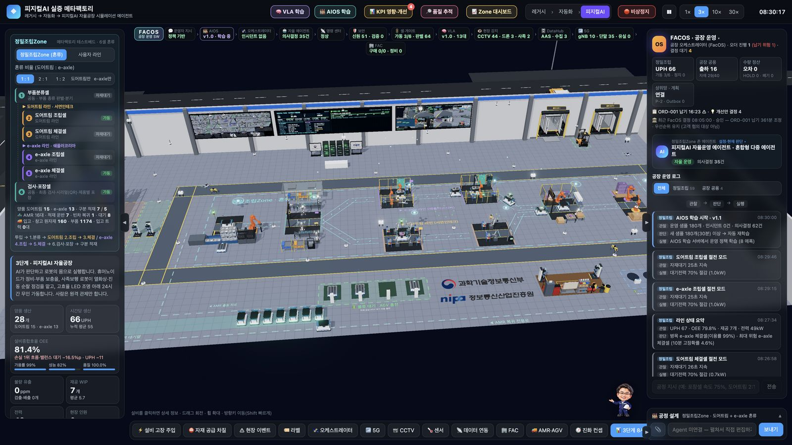

화면 전체에 3D 공장이 깔리고, 그 위에 상단 바 · 왼쪽 패널 · 오른쪽 패널 · 하단 바 · 공정 설계 도크 · 안내 아바타 토리가 겹쳐 있음. 피지컬AI 단계에서는 상단 바 아래에 FACOS 계층 띠가 더 나옴(5.14절).

### 2.1 상단 바

| 위치 | 요소 | 기능 |
|---|---|---|
| 왼쪽 | 제목 「피지컬AI 실증 메타팩토리」 | — |
| 가운데 | 「🧠 VLA 학습」「🏭 AIOS 학습」 | 로봇 학습·공장 운영 AI 파이프라인 창 (피지컬AI 단계에서만 보임, 5.13) |
| 가운데 | 「📊 KPI 영향·개선」 (숫자 배지) | 이벤트가 KPI에 준 영향과 개선 제안 (5.4) |
| 가운데 | 「🔎 품질 추적」 (숫자 배지) | 제품 계보·불량 원인 분석·8D (5.5) |
| 가운데 | 「📈 Zone 대시보드」 | 정밀조립Zone 실시간 모니터링 · OEE · 관리도 (5.18) |
| 가운데 | 「레거시 › 자동화 › 피지컬AI」 | 운영 단계 전환 (3.3) |
| 가운데 | 「🛑 비상정지」 | 정밀조립Zone 전체 비상정지 / 발령 중에는 리셋 명령 (4.4) |
| 오른쪽 | 「❚❚」/「▶」 | 일시정지 / 재생 |
| 오른쪽 | 「1× 3× 10× 30×」 | 배속 (기본 3×) |
| 오른쪽 | 시계 (시작 08:00:00) | 공장 기준 시각 |
| 오른쪽 | 「📘」 | 이 사용자 가이드를 PDF(`Jin-3D_사용자가이드.pdf`)로 내려받음 — `docs/USER_GUIDE.pdf` 가 있을 때만 보임 |
| 오른쪽 | 「⚙」 | Agent API 키 설정 (맥·윈도우 앱 · 웹 버전) |

※ 「⬇」(맥·윈도우 앱 내려받기)는 웹 버전에서 릴리스 주소가 설정돼 있을 때만 보이는 버튼이며, 지금은 주소가 비어 있어 나오지 않음.

### 2.2 왼쪽 패널 — 정밀조립Zone · KPI

| 요소 | 내용 |
|---|---|
| 라인 선택 | 「정밀조립Zone (혼류)」 / 「사용자 라인」. 바꾸면 시뮬레이션이 다시 시작됨 |
| 혼류 비율 (도어트림 : e-axle) | 「1 : 1」「2 : 1」「1 : 2」「도어트림만」「e-axle만」. 투입 순서는 비율에 맞춰 평준화됨 |
| 셀 목록 | 1 부품분류셀 → 도어트림 라인(2 조립셀 · 3 체결셀) / e-axle 라인(4 조립셀 · 5 체결셀) → 6 검사·포장셀. 셀별 상태 칩(가동 · 자재대기 · 배출대기 · 고장 등). 누르면 설비 상세 창(5.1) |
| 현황 줄 | 양품(도어트림 · e-axle) · 구분 적재 · AMR 16대의 적재 운반/빈차 복귀/대기 · 창고 원자재·부품 재고 · 입고 트럭 |
| 단계 설명 | 「1단계 · 레거시 공장」「2단계 · 자동화 공장」「3단계 · 피지컬AI 자율공장」 |
| KPI 타일 | 「양품 생산」「시간당 생산」「설비종합효율 OEE」「불량 유출」「재공 WIP」「전력」「현장 인원」「고장」「자재 / 완제품」 |
| 개선 제안 줄 | 「💡 개선 제안 n건 — … · 적용하시겠습니까?」 → 누르면 KPI 영향 창 |
| 추이 차트 | 「시간당 생산량 (UPH, 최근 10분)」「OEE (누적, %)」 |

### 2.3 오른쪽 패널 — FACOS · 공장 운영

| 요소 | 내용 |
|---|---|
| 「FACOS · 공장 운영」 머리말 | 공장 오케스트레이터(FacOS)의 오더 진행 수 · 납기 위험 · 결정 대기 수. 누르면 아래 요약을 접고 펼침(상태 기억) |
| 요약 칩 | 「정밀조립」(UPH · 가동 셀) · 「공장 공용」(출하 · 자재) · 「수량 정산」(오차 · HOLD · 폐기) · 「상위망 · 계획」(연결 상태 · 계획 버전 P-n · Outbox). 정밀조립 · 공장 공용 칩을 누르면 로그가 그쪽만 보이게 걸러짐 |
| 오더 · 결정 줄 | 진행 중 오더(예: 「ORD-001 납기 …」)와 「최근 FacOS 결정」 |
| 「정밀조립Zone 존 에이전트 설정·현재 판단 ▾」 | 펼치면 엔진(「정책 기반」 — 명시적 운영 정책(조건·기준값)으로 판단, 학습 모델·LLM이 아님 / 「대화 기반」), 「응답 대기 시 일시정지」, 구조(「단일 에이전트」/「혼합형 다중」), 「🔬 트윈 비교」, 현재 판단 |
| 「공장 운영 로그」 | 「관찰 → 판단 → 실행」 형식의 에이전트 기록. 필터 「전체 · 정밀조립 · 공장 공용」 |
| 지시 입력창 | 대화 기반일 때만 입력 가능 (5.3) |

### 2.4 하단 바

| 버튼 | 기능 |
|---|---|
| 「⚡ 설비 고장 주입」 | 임의 설비에 돌발 고장 (4.1) |
| 「⛔ 자재 공급 차질」 | 자재 창고 출고를 10분간 중단 (4.2) |
| 「⚠ 현장 이벤트」 | 누유·이물질·무단 진입·연기 의심 중 하나 발생 (피지컬AI 전용, 4.3) |
| 「🏷 라벨」 | 3D 설비·로봇 라벨 켜기/끄기 (처음에는 꺼진 채 시작) |
| 「🛰 오케스트레이터」 | 인시던트 흐름 · 제어 흐름 · 명령 콘솔 · FacOS 계층 · A2A 메시지 · UNS 토픽 트리 (4.5 · 5.15) |
| 「📶 5G」「📹 CCTV」 | 무선 커버리지·CCTV 사각지대 지도 (5.9·5.10) |
| 「🌡 센서」「📡 데이터 연동」 | 센서망·표준 데이터 연동 (5.7·5.8) |
| 「🏢 FAC」「🚚 AMR·AGV」 | 업무 기록·이동 로봇 관제 (5.11·5.12) |
| 「🧭 진화 컨셉」「📊 3단계 8시간 비교」 | 단계별 비교 (5.6) |
| 「↺ 리셋」 | 현재 단계를 처음부터 다시 시작 |

※ 진행 중인 건이 있으면 주입 버튼이 깜빡이며(고장 빨강 · 공급 차질 주황 · 현장 이벤트 노랑) 건수 또는 남은 시간이 표시됨.

### 2.5 공정 설계 도크

오른쪽 아래 「🏭 공정 설계」 제목줄을 누르면 펼쳐짐 (5.2).

---

## 3. 기본 조작

### 3.1 3D 화면 조작

| 동작 | 결과 |
|---|---|
| 마우스 드래그 | 시점 회전 |
| 휠 | 확대·축소 |
| 설비·셀 클릭 | 설비 상세 창 (5.1) |
| 로봇·AMR 클릭 | 로봇 정보 창 (5.1) |
| CCTV 카메라·전광판 클릭 | CCTV 영상 창 (5.9) |
| 5G 기지국 클릭 | 기지국 정보 창 (5.10) |
| 빈 곳 클릭 | 열린 정보 창이 닫힘 |

※ 끌어서 회전·이동할 때는 클릭으로 인식하지 않음. 가운데 창(데이터 연동 · FAC · 품질 추적 등)은 창 바깥 어두운 바탕을 누르면 닫힘.

### 3.2 키보드 단축키

| 키 | 기능 |
|---|---|
| `[` / `]` | 왼쪽 / 오른쪽 패널 숨기기·보이기 (패널 가장자리 「◀」「▶」 탭도 같음) |
| `\` (한글 자판 `₩`) | 공정 설계 도크 숨기기·보이기 |
| 방향키 | 화면 기준으로 시점 이동 (Shift와 함께 누르면 2.5배 빠름) |
| `P` | 구간별 성능 표시 켜기·끄기 (5.20) |
| ⌘, (맥) · Ctrl+, (윈도우) | Agent API 키 설정 |

※ 입력창에 글을 쓰는 중에는 방향키가 동작하지 않음. 패널 숨김 상태는 브라우저에 기억됨.

### 3.3 운영 단계 전환

| 단계 | 의미 | 특징 |
|---|---|---|
| 레거시 | 작업자 중심·사후 보전 | 작업자 수작업 · 고정 컨베이어 · 유인 지게차. 명령 전달은 무전·구두 지시 약 8초. 대화 기반 Agent 사용 불가 |
| 자동화 | 로봇·MES 기반 | 협동로봇·6축 셀 · AMR 16대. 명령 전달 MES → PLC 약 0.6초 |
| 피지컬AI (처음 실행 단계) | 휴머노이드·AMMR·VLA·자율 에이전트 | 「⚠ 현장 이벤트」「🧠 VLA 학습」「🏭 AIOS 학습」, FACOS 계층 띠, 현장 대응 팝업, CCTV AI 분석이 추가로 동작. 명령 전달 OPC UA PubSub/TSN 약 0.2초 |

- 단계를 바꾸면 그 단계로 시뮬레이션이 새로 시작됨.
- 같은 단계를 처음부터 다시 보려면 「↺ 리셋」을 누름.

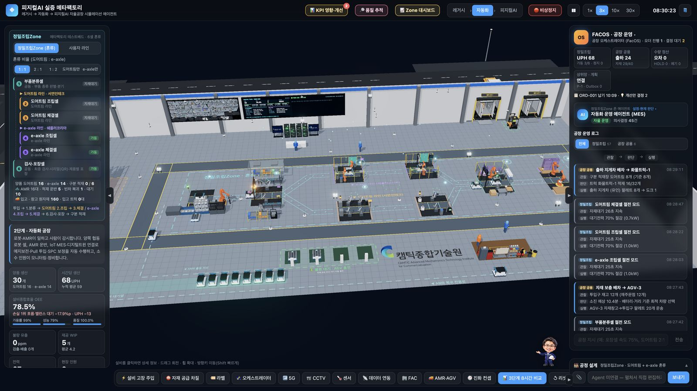

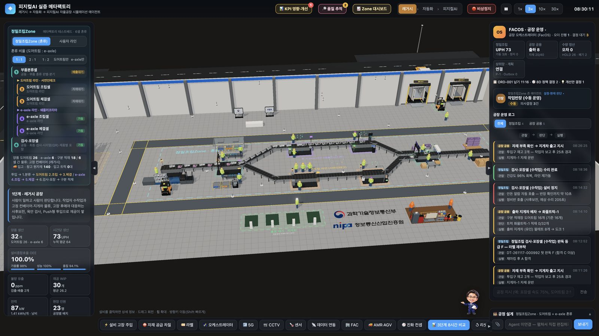

### 3.4 재생·배속

- **(배속)** 「1×」「3×」「10×」「30×」 중 선택. 긴 시간 흐름을 볼 때는 10× 이상을 씀.
- **(일시정지)** 「❚❚」를 누르면 멈추고 「▶」로 재개함. 일시정지 중에도 창 열기·내려받기는 가능함.

---

## 4. 운영 시나리오 실습

### 4.1 설비 고장 주입

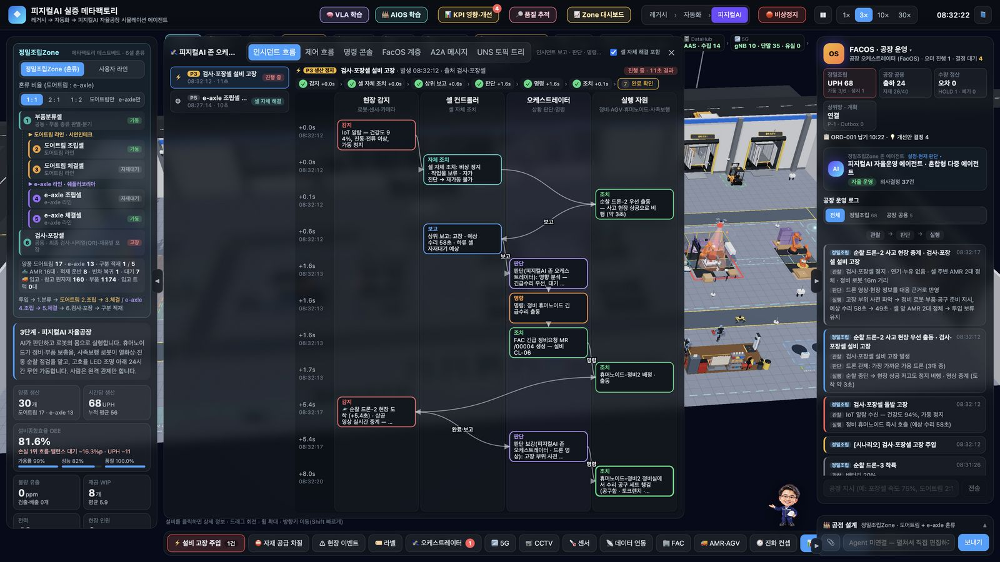

1. 「⚡ 설비 고장 주입」을 누름 → 셀 하나에 무작위 고장이 발생하고 오케스트레이터 창이 열림.
2. 「인시던트 흐름」 탭에서 감지 → 셀 자체 조치 → 상위 보고 → 판단 → 명령 → 조치 → 완료 확인 순서를 스윔레인(현장 감지 · 셀 컨트롤러 · 오케스트레이터 · 실행 자원)으로 확인함. 왼쪽 목록에서 인시던트(P1~P5 우선순위)를 고름.
3. 특정 설비를 고장 내려면 그 설비를 클릭해 설비 상세 창의 「⚡ 고장 주입」을 누름.

### 4.2 자재 공급 차질

- 「⛔ 자재 공급 차질」을 누르면 자재 창고 출고가 10분간 멈춤. 버튼에 남은 시간이 표시되고, 미니로드 선반에 출고 중단 표지가 뜨며 AGV는 출고 재개를 기다림.
- 자동화·피지컬AI 단계에서는 오케스트레이터가 안전재고 긴급 운송·대체 발주로 대응하고, 그 판단이 로그와 인시던트 흐름에 남음.

### 4.3 현장 이벤트 (피지컬AI 단계)

- 「⚠ 현장 이벤트」를 누르면 바닥 누유 · 바닥 이물질 · 안전구역 무단 진입 · 연기 의심 중 하나가 로봇 카메라 앞에 발생함.
- 로봇 영상 AI가 감지하고 정비 휴머노이드·사족보행·순찰 드론이 자율 대응하는 과정은 오케스트레이터, 화면 아래 현장 대응 팝업(5.16), CCTV 이벤트 이력에서 확인함.
- 이벤트 반경(누유 1.3m · 이물질 1.0m · 연기 1.8m · 무단 진입 2.2m)에는 대응 로봇만 들어가고, 다른 이동 로봇은 우회하거나 앞에서 멈춰 기다림.

### 4.4 비상정지·리셋

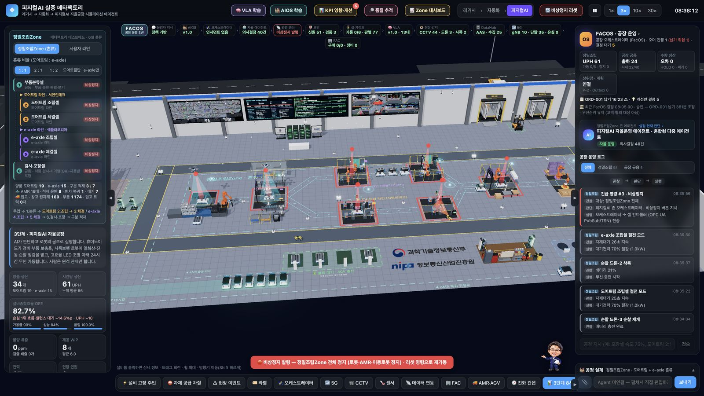

1. 상단 「🛑 비상정지」를 누름 → 정밀조립Zone 전체 로봇·AMR·이동로봇이 정지하고 배너 「🛑 비상정지 발령 — …」이 표시됨.
2. 재가동하려면 같은 버튼(리셋)을 누름 → 「🔄 비상정지 해제 — 셀 자가진단 중」 후 운전이 재개됨.

### 4.5 오케스트레이터 창

「🛰 오케스트레이터」로 열며, 탭 6개로 구성됨.

| 탭 | 내용·조작 |
|---|---|
| 「인시던트 흐름」 | 인시던트 목록(P1~P5 우선순위), 처리 스윔레인, 「셀 자체 해결 포함」 체크 |
| 「제어 흐름」 | 「공정별 제어 흐름도」(STEP1~STEP6)/「흐름 분석」 보기, 「전체·제어·이벤트」 필터 |
| 「명령 콘솔」 | 대상(「정밀조립Zone 전체」 또는 셀) 선택 후 명령 전송, 「셀 명령 상태」·「명령 이력」 |
| 「FacOS 계층」 | 공장 → 존 → 존 에이전트 → 셀 OCS 계층, 오더·공장 결정·운영 변경 이력 표, 「고정 운영 규칙 6종」 (5.15) |
| 「A2A 메시지」 | 공장 ↔ 존 ↔ 셀 메시지, 「🔌 상위망 단절 시험」, 「🛡 가드레일 시험 (셀 → 공장 건너뛰기)」, 「⬇ 메시지 기록 (.jsonl)」 (5.15) |
| 「UNS 토픽 트리」 | ISA-95 통합 네임스페이스 토픽 트리, 브로커 상태, 외부 브로커 연결, Sparkplug B, 접근 권한 (5.15) |

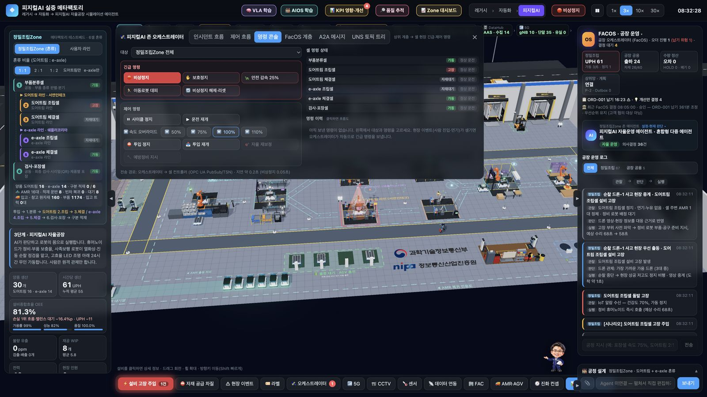

명령 콘솔에서 보낼 수 있는 명령:

| 구분 | 명령 |
|---|---|
| 긴급 명령 | 🛑비상정지 · ✋보호정지 · 🐢안전 감속 25% · 🏃이동로봇 대피 · 🔄비상정지 해제·리셋 |
| 제어 명령 | ⏸사이클 정지 · ▶운전 재개 · ⏩속도 오버라이드 50/75/100/110% · ⛔투입 정지 · 📥투입 재개 · 🎯자율 재보정 · 🔧예방정비 지시 |

※ 명령 전달 경로·지연은 단계마다 다름 — 레거시 「무전·구두 지시 → 작업자 조작」 약 8초(비상정지 3초), 자동화 「MES → PLC (OPC UA)」 약 0.6초(0.3초), 피지컬AI 「오케스트레이터 → 셀 컨트롤러 (OPC UA PubSub/TSN)」 약 0.2초(0.05초).

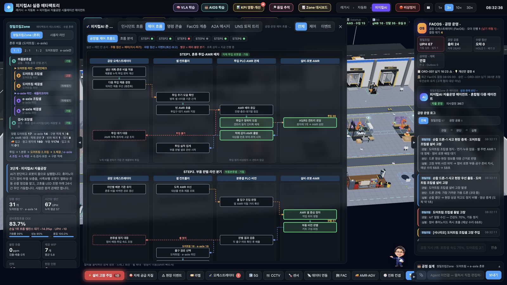

---

## 5. 기능별 사용법

### 5.1 설비 상세 창 · 로봇 정보 창

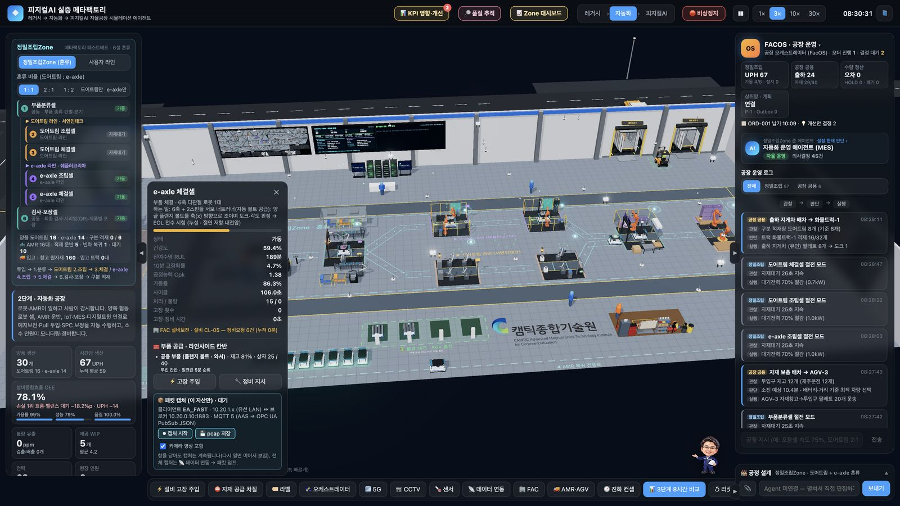

- **(여는 법)** 3D에서 설비를 클릭하거나 왼쪽 셀 목록을 누름.
- **(설비 상세)** 하는 일 · 상태 · 건강도 · 잔여수명 RUL · 10분 고장확률 · 공정능력 Cpk · 가동률 · 사이클 · 처리/불량 · 고장 횟수 · 고장·정비 시간 · FAC 설비보전 요약. 셀에 따라 「🧰 서열 키팅」(부품분류셀) · 「🧰 부품 공급 · 라인사이드 칸반」(조립·체결셀) · 시리얼 발행·판독 등급(검사·포장셀)이 더 나옴. 「⚡ 고장 주입」「🔧 정비 지시」 버튼.
- **(개별 패킷 캡처)** 「⏺ 캡처 시작」 → 중지 → 「💾 pcap 저장」. 「카메라 영상 포함」을 체크하면 영상 메시지도 담김. 창을 닫아도 캡처는 계속됨.

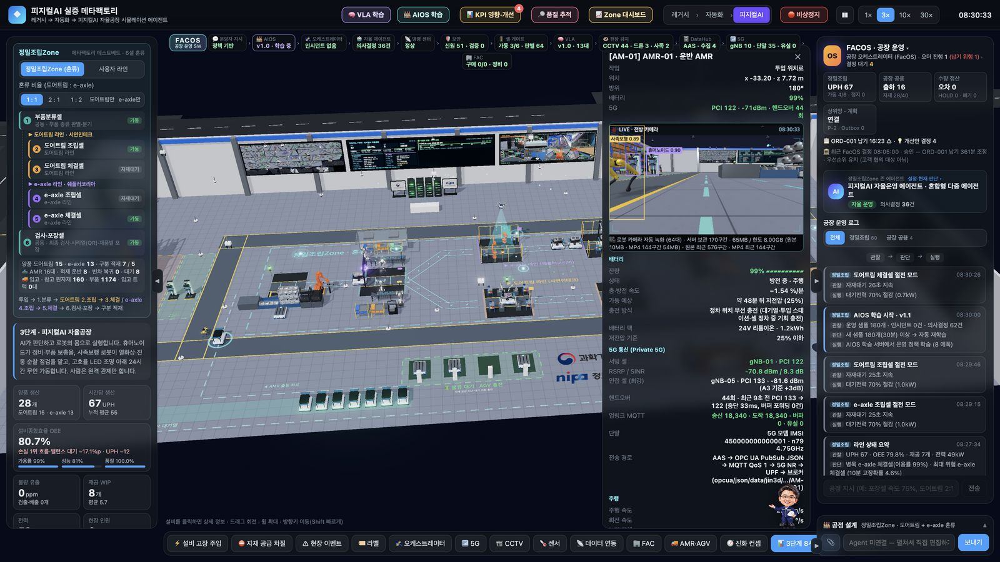

- **(로봇 정보)** 작업 · 위치 · 배터리(잔량 · 충·방전 속도 · 가동 예상) · 5G 통신(서빙 셀 · RSRP/SINR · 핸드오버 · 업링크 MQTT) · 주행 · 센서 값. 팔이 있는 로봇은 관절 표와 「관절 위치 추이」 차트가 나옴. 피지컬AI 단계에서는 로봇 카메라 실시간 영상과 AI 인식 상자가 함께 나옴.
- **(누적 데이터 저장)** 「💾 누적 데이터 저장 (AAS)」에서 형식(「AASX 패키지 (AAS Part 5, 권장)」·「AAS JSON」·「AAS XML」·「AAS RDF (Turtle)」)과 버전(「AAS v3.1」/「AAS v3.0」)을 고르고 「저장」.
- 창 바깥을 누르면 닫힘.

### 5.2 공정 설계

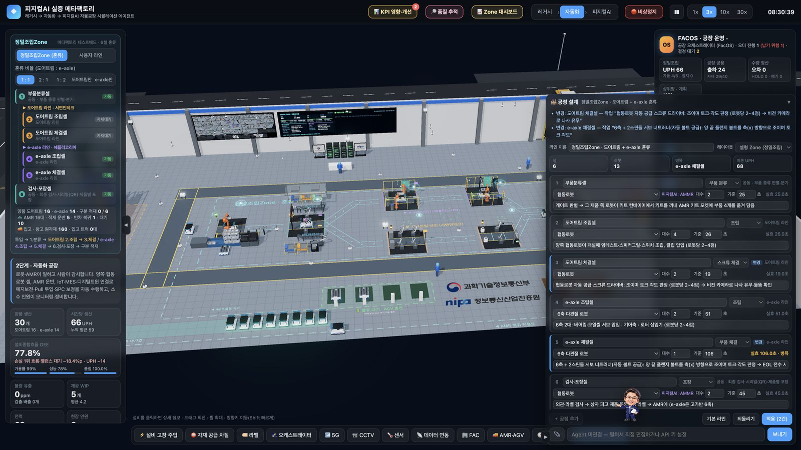

1. 오른쪽 아래 「🏭 공정 설계」를 눌러 펼침.
2. 공정(셀) 카드에서 공정명·공정 유형·로봇 종류·대수·기준 사이클(초)·하는 일을 고침. 정밀조립Zone(혼류)은 셀 구성·순서가 고정이라 셀 레시피만 바꿀 수 있고, 「사용자 라인」에서는 순서 변경·삭제와 「＋ 공정 추가」(공정 최대 8개 · 공정당 로봇 최대 4대)를 쓸 수 있음.
3. 위쪽 지표(셀 · 로봇 · 병목 · 이론 UPH)와 변경 내역, 카드마다의 실효 사이클을 확인함.
4. 「적용 (n건)」을 누르면 3D 공장과 시뮬레이션이 새 라인으로 다시 시작됨. 「되돌리기」는 편집 취소, 「기본 라인」은 초기값 복원.

- **(Agent로 설계)** 하단 입력줄에 요청을 쓰고 「보내기」. 「📎」 또는 끌어다 놓기로 공정도·레이아웃 파일(PDF · 이미지 · 엑셀 · 워드 · 텍스트, 한 번에 10개, PDF 25MB 이하)을 첨부하면 「파일에서 읽은 내용」을 반영한 초안이 나옴. 초안은 사람이 「적용」을 눌러야 반영됨.
- **(HWP)** 한글(HWP) 파일은 직접 읽을 수 없으므로 한글에서 PDF로 저장해 첨부함.
- **(Agent 미연결 · 웹 버전)** 직접 편집만 가능함.
- **(피지컬AI 전용 로봇)** AMMR · 휴머노이드는 피지컬AI 단계에서만 고를 수 있고, 레거시·자동화 단계에서는 같은 대수의 협동로봇으로 운영됨.
- 적용한 라인은 다음 실행에도 남음.

### 5.3 운영 에이전트와 대화 지시

- **(준비)** 오른쪽 패널의 「정밀조립Zone 존 에이전트 설정·현재 판단 ▾」을 펼쳐 엔진을 「대화 기반」으로 바꿈 → 아래 입력창이 열림 (자동화·피지컬AI 단계).
- **(Agent 연결)** 맥·윈도우 앱은 1.5절의 API 키, `npm start`는 1.4절의 `.env`(API 키 또는 Claude 구독), 웹 버전은 1.6절의 API 키로 연결함. 연결하지 않아도 내장 해석기는 동작함.
- **(입력)** 지시를 쓰고 「전송」. 쉼표·「그리고」로 여러 지시를 한 번에 줄 수 있음.
- **(판정)** 지시마다 해석 → 대상 확인 → 안전 규칙 → 실행 가능성 → 영향 평가 게이트를 거쳐 수행 또는 거절(사유 · 대안)로 로그에 남음. 로그의 지시 게이트 항목을 누르면 판정 도식 창이 열림.
- **(계획 변경)** 혼류 비율 · 투입 간격 · 긴급 조달은 FacOS 결정을 거쳐 계획 버전(P-n)을 올린 뒤 적용됨(5.15).
- **(응답 대기)** 「응답 대기 시 일시정지」가 켜져 있으면 Agent 응답을 기다리는 동안 시뮬레이션이 멈춤.
- **(구조 비교)** 「단일 에이전트」/「혼합형 다중」을 운전 중에 바꿀 수 있고, 「🔬 트윈 비교」에서 같은 조건의 디지털트윈으로 두 구조의 성과를 비교함.

내장 해석기가 알아듣는 지시 (API 키 없이 동작):

| 의도 | 예문 |
|---|---|
| 속도 조정 | 「포장셀 속도 75%」, 「e-axle 체결셀 빠르게」 (30~120%) |
| 혼류 비율 | 「도어트림 2:1로 생산」, 「e-axle만」, 「반반」 |
| 정비·보정 | 「e-axle 조립셀 예방정비」, 「도어트림 체결셀 재보정」 |
| 투입 | 「투입 정지」, 「투입 재개」, 「투입 간격 10초」 (허용 범위 5~20초) |
| 안전 | 「전체 보호정지」, 「보호정지 해제」, 「안전 감속」, 「감속 해제」, 「대피」, 「비상정지」, 「비상정지 리셋」 |
| 사이클 | 「포장셀 사이클 정지」, 「재개」 |
| 상태 질의 | 「부품분류셀 상태 어때?」, 「현황 알려줘」 |

※ 바꿔 말하기 — 「분류셀 손 좀 봐줘」(정비), 「도어트림 체결셀 다시 맞춰줘」(재보정), 「급하게 멈춰」(비상정지), 「재료 공급 쉬어」(투입 정지), 「넣는 주기 8초로」(투입 간격), 「비상 재고 풀어」(긴급 조달), 「모두 나가」(대피), 「반쯤 속도로」·「포장셀 60퍼로」(속도), 「포장셀 사이클 원래대로」(그 셀 속도 100%), 「액슬 위주로」·「도어트림은 절반만」(혼류), 「요즘 괜찮아?」(상태)도 알아들음. 「검사셀」·「포장셀」은 모두 검사·포장셀, 「이액슬」·「액슬」은 e-axle을 가리킴. 수치만 있는 다음 문장은 앞 문장에 붙여 해석함(「투입 간격 너무 짧아, 15초로」).
※ 하지 말라는 지시(「비상정지 하지 마」)는 명령을 보내지 않고, 대상 셀이 불분명하면 전체로 넘기지 않고 후보 셀을 돌려줌. 해석하지 못한 문장은 Claude가 연결되어 있을 때만 Agent가 해석해 같은 게이트로 반영함.

### 5.4 KPI 영향·개선

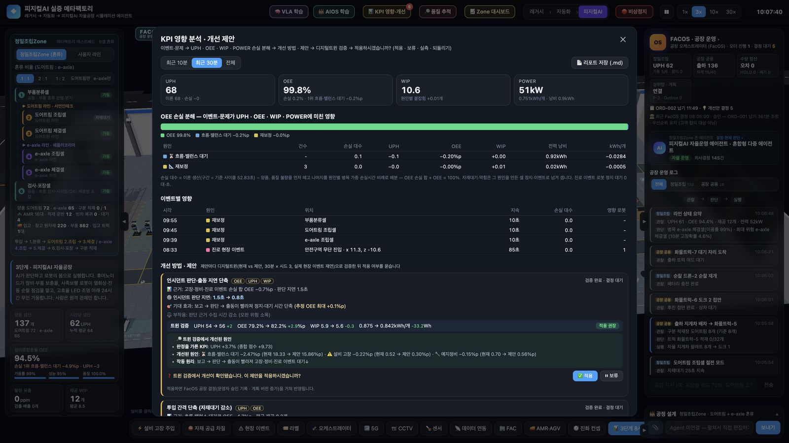

1. 상단 「📊 KPI 영향·개선」 또는 왼쪽 「💡 개선 제안」 줄을 누름.
2. 기간(「최근 10분」「최근 30분」「전체」)을 고르고 UPH·OEE·WIP·POWER 타일과 「OEE 손실 분해」 · 「이벤트별 영향」을 확인함.
3. 「개선 방법 · 제안」 카드에서 근거·바꿀 운영값·기대 효과·부작용을 읽음. 제안마다 디지털트윈(현재 vs 제안, 30분 × 시드 3, 실제 현장 이벤트 재연) 결과가 「적용 권장」/「효과 미미」/「보류 권장」으로 나옴.
4. 「✅ 적용」 또는 「⏸ 보류」를 고름. 적용은 FacOS 결정을 거쳐 반영되고(5.15) 적용 후 실측 효과가 표시되며, 필요하면 되돌림.
5. 「📄 리포트 저장 (.md)」으로 분석 리포트를 내려받음. 계산 방법은 [KPI 영향 분석 보고서](KPI_IMPACT_REPORT.md) 참조.

### 5.5 품질 추적·불량 원인 분석·8D

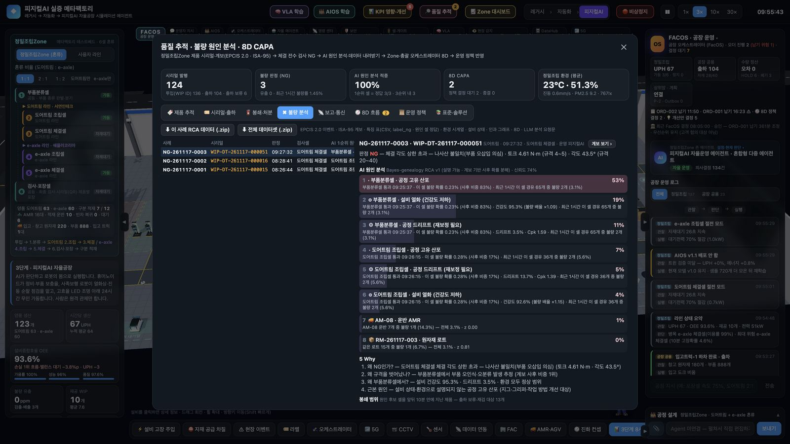

상단 「🔎 품질 추적」(정책 결정 대기 수 배지)으로 엶. 위쪽 타일에 시리얼 발행 · 불량 판정(NG) · AI 원인 분석 적중 · 8D CAPA · 정밀조립 환경(평균)이 나옴.

| 탭 | 사용법 |
|---|---|
| 「🔖 제품 추적」 | 시리얼 · WIP ID · EPC · AMR · 로트로 제품을 찾아 셀별 공정 단계·파라미터·환경 계보 확인 |
| 「🏷 시리얼·출하」 | 「시리얼 · WIP ID · SSCC · 트럭 검색」으로 제품을 찾음. 행을 누르면 실제로 읽히는 QR 코드, GS1 AI 내용, 판독 등급, EPC, 공정 이력, 출하 팔레트(SSCC)·트럭 확인. 「🔎 EPCIS 저장소에서 조회」 |
| 「🧯 봉쇄·처분」 | 출하 전 샘플 재검 로트(판정 대기 → OK 해제 / NG 봉쇄 → 선별검사), 처분 기록(MRB — 재작업·폐기), 유출 의심(회수 대상)·샘플링 강화 상태 |
| 「✖ 불량 분석」 (기본) | 사례별 AI 원인 순위·근거·5 Why·봉쇄 범위. 「⬇ 이 사례 RCA 데이터 (.zip)」「⬇ 전체 데이터셋 (.zip)」 |
| 「📡 보고·통신」 | 검사셀 엣지 → MQTT 브로커 → 메인 서버 → RCA 서버 메시지 흐름. 「⬇ 이 사례 통신 (.pcap)」「⬇ 전체 품질 통신 (.pcap)」「⬇ 이 사례 리포트·RCA 결과 (.json)」, 「실서버 연결」 상태 |
| 「🧭 8D 흐름」 | D0~D8 진행 스윔레인. 「자동 반영」 체크 시 대책 자동 승인, 아니면 「정책 반영하시겠습니까?」에서 「✔ 정책 반영」/「보류」 직접 선택 |
| 「📜 운영 정책」 | 현재 품질 운영 정책(예지정비 착수 건강도 · 재보정 시작 Cpk · 환경 인터록)과 이력, 되돌리기 |
| 「📚 표준·솔루션」 | 적용 표준·외부 솔루션 안내 |

**시리얼·마킹 (2단 ID)**

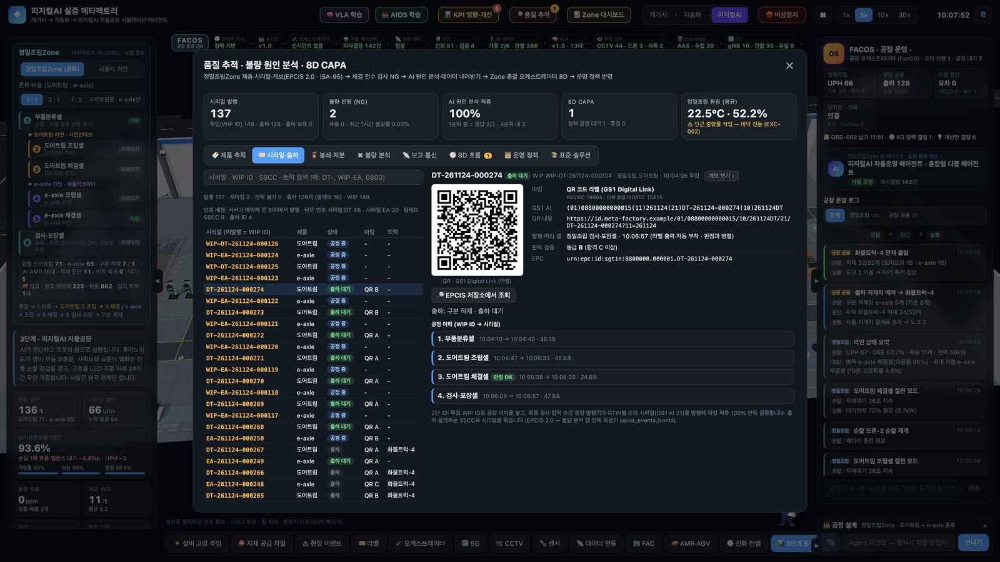

- **ID 두 단계**: 투입할 때 WIP ID(예: `WIP-DT-261117-000128`)로 공정 이력을 쌓고, 검사·포장셀의 최종 외관·라벨 검사에 합격하는 순간 제품 시리얼(예: `DT-261117-000847` · `EA-…`)을 제품 코드별 순번으로 발행함. 체결 전수 검사 NG품은 시리얼 없이 WIP ID로 배출함에 격리되고, 폐기한 시리얼은 다시 쓰지 않음.
- **마킹**: QR 라벨(GS1 Digital Link · ISO/IEC 18004). 코드 내용은 (01) GTIN · (11) 생산일 · (21) 시리얼 · (10) 로트이며, 읽으면 `https://id.meta-factory.example/01/…/10/…/21/…?11=…` 주소(가상 도메인)가 나옴.
- **판독 검증**: 마킹 직후 모두 읽어 등급을 매김 (C 이상 합격). 실패하면 한 번 다시 부착하고(그 시간만 사이클에 더해짐), 다시 실패하면 출하 보류 뒤 수작업 재부착함. 검사·포장셀 상세 창 「🏷 시리얼 발행·마킹」에 발행 수·등급 분포·재마킹 수가 나옴.
- **출하**: 출하 지게차가 팔레트를 실을 때 팔레트마다 SSCC(AI 00, 18자리)를 붙이고 어떤 시리얼이 어느 트럭에 실렸는지 기록함. 트럭이 한 번 출발할 때마다 출하 ID(`SHP-날짜-번호`)를 붙임. SSCC · 출하 ID · 시리얼 번호는 단계를 바꿔도 이어지고, 앱은 다시 켜도 EPCIS 저장소에 남은 마지막 번호 뒤부터 씀. 출하 보류 중인 제품은 싣지 않음.

**출하 전 샘플 재검 · 봉쇄 · 처분**

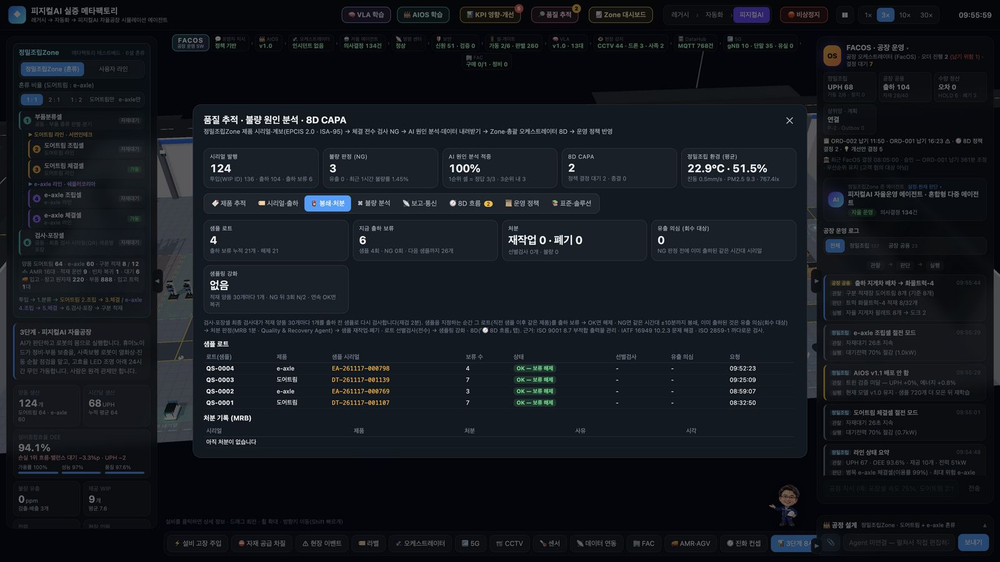

이 시뮬레이터에는 정밀검사Zone이 없어, 검사·포장셀 최종 검사대가 출하 전에 샘플을 다시 검사함(샘플을 옮기는 장면 없이 적재장에 보류 상태로 둠).

1. 적재 양품 30개마다 1개를 샘플로 지정하고, 그 순간 그 로트(직전 샘플 이후 같은 제품)를 출하 보류함.
2. 재검 시간 — 레거시 600초(10분) · 자동화 240초(4분) · 피지컬AI 120초(2분) — 뒤 판정함. OK면 로트 · 샘플 보류를 풂.
3. NG면 같은 시간대 ±10분 제품까지 봉쇄하고, 이미 출하된 같은 시간대 제품은 「유출 의심 (회수 대상)」으로 표시하며, 불량 사례와 8D가 열림.
4. 처분 판정(MRB): 레거시 30분 · 자동화 5분 · 피지컬AI 1분. NG 샘플은 재작업(재검 합격 시 시리얼 유지) 또는 폐기(시리얼 폐기 기록), 봉쇄 로트는 선별검사(전수) 뒤 양품만 해제함.
5. 샘플링 강화: NG 뒤 다음 샘플 3회는 15개마다 1개, 3회 연속 OK면 원래 주기(30개)로 돌아감.

※ 재작업 가능 비율(70%)과 재검에서만 드러나는 결함 비율(4%)은 설계 가정값임. 「⬇ 전체 데이터셋 (.zip)」에 `serial_events.jsonld`(EPCIS 2.0)와 `serials.csv`가 들어 있음.

**불량 원인 분석 · 8D**

- **불량 사례**: 체결셀 토크·각도 전수 검사 NG와 출하 전 샘플 재검 NG가 사례(`NG-날짜-번호`)가 됨. 사례마다 판정·규격 · 계보 · 그 시간대 환경 이상 · 봉쇄 범위 · AI 원인 분석(계보 기반 베이즈 분해 — 신경망이 아닌 설명 가능한 규칙 계산)이 붙음.
- **8D 흐름**: D0 NG 판정·격리 → D1 팀 구성 → D2 문제 기술 → D3 임시 조치(봉쇄) → D4 근본 원인 → D5 대책 선정 → 「정책 반영하시겠습니까?」 → D6 시행·검증 → D7 재발 방지(정책) → D8 종결.
- **RCA 서버(더미)**: 실제 원인 분석 엔진이 아니라 리포트에 실려 온 내장 분석 순위에 판정 규칙만 적용하는 자리표시 서버임. 앱·`npm start`에서는 앱 서버의 `/api/rca/v1/`로 열리고, 단독 실행은 `npm run rca-server`(기본 127.0.0.1:8775).

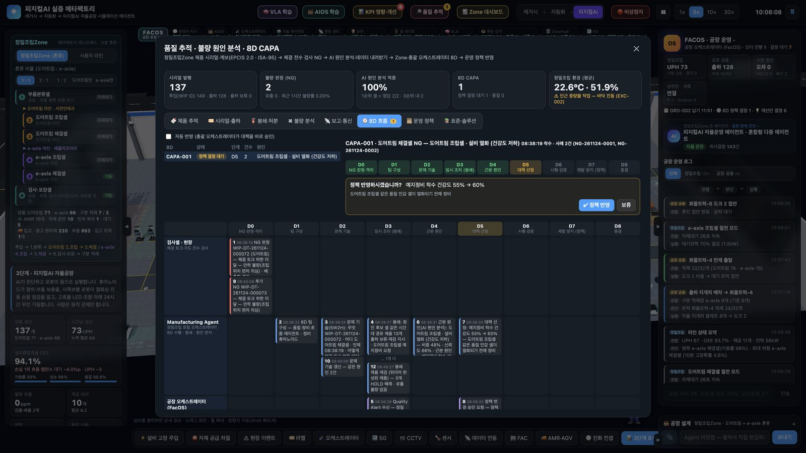

### 5.6 3단계 8시간 비교 · 진화 컨셉

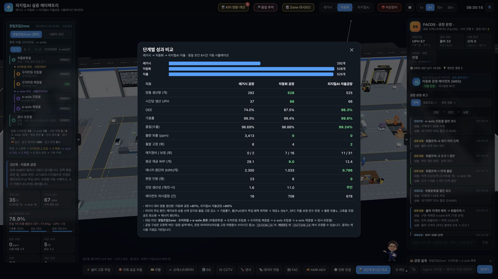

- 「📊 3단계 8시간 비교」를 누르면 같은 라인·같은 조건으로 레거시·자동화·피지컬AI를 8시간씩 계산해 막대그래프와 지표 13종 표(양품 생산량 · UPH · OEE · 가용률 · 품질 · 불량 유출 · 돌발 고장 · 예지정비/보정 · 평균 재공 · 에너지 원단위 · 현장 인원 · 인당 생산성 · 에이전트 의사결정)를 보여 줌. 처음에는 계산에 수십 초가 걸림. 속도 때문에 정책 기반 에이전트로 계산하며, 결과는 예시용 가정값 기반임.

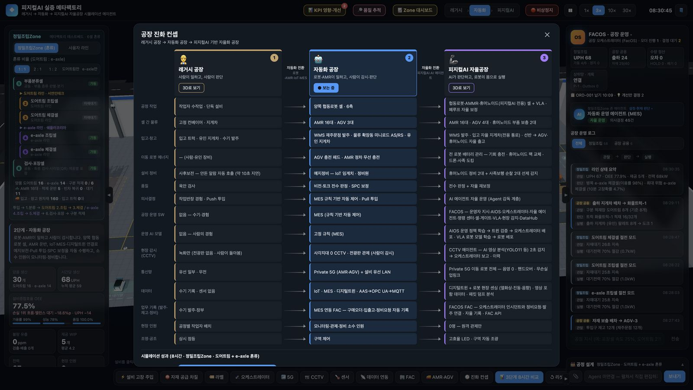

- 「🧭 진화 컨셉」은 세 단계 공장의 차이를 항목별로 비교함. 열마다 「3D로 보기」를 누르면 그 단계로 전환됨.

### 5.7 데이터 연동

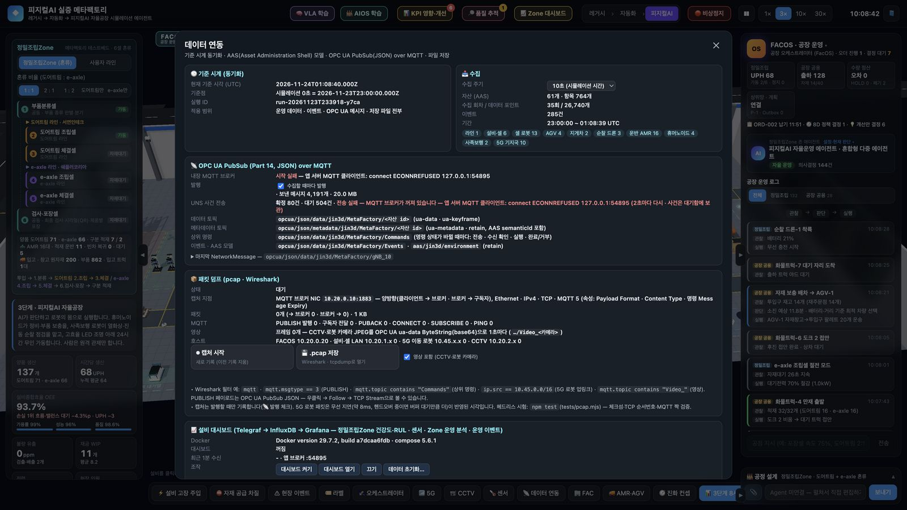

| 영역 | 사용법 |
|---|---|
| 「🕒 기준 시계 (동기화)」 | 모든 데이터·메시지가 쓰는 기준 시각(UTC)·실행 ID 확인 |
| 「📥 수집」 | 「수집 주기」 1/5/10/30초 선택, 자산(AAS)·이벤트 수 확인 |
| 「📡 OPC UA PubSub (Part 14, JSON) over MQTT」 | 내장 MQTT 브로커 상태, 「수집할 때마다 발행」 체크, 토픽 목록(`opcua/json/data/jin3d/MetaFactory/<자산 id>` 등). 외부 PC에서 MQTT Explorer로 `opcua/json/#` 구독 가능 |
| 「📦 패킷 덤프 (pcap · Wireshark)」 | 「⏺ 캡처 시작」→ 중지 →「💾 .pcap 저장」, 「영상 포함 (CCTV·로봇 카메라)」 체크 |
| 「📈 설비 대시보드」 | 설비 건강도·RUL · 센서 · Zone 운영 분석 · 운영 이벤트를 시계열로 쌓아 Grafana로 봄 (앱 전용). 아래 참조 |
| 「🗂 EPCIS 저장소」 | 시리얼 발행·포장 묶음·출하·보류·처분 이벤트(GS1 EPCIS 2.0)를 모아 둠. 아래 참조 |
| 「💾 저장」 | AAS 메타모델 버전(「v3.1 (기본)」/「v3.0 (구버전 호환)」) 선택 후 「JSON」「XML」「RDF」「CSV」「AutomationML」 |

※ AAS 식별자 체계와 서브모델 구성은 [AAS 스키마](AAS_SCHEMA.md) 참조. 값은 시뮬레이션 결과이며 자산 정보의 제조사명은 「가상 자산」으로 표시됨.

**EPCIS 저장소 (GS1 EPCIS 2.0)**

- **설치할 것 없음**: 맥 앱·윈도우 앱·`npm start`는 앱 안 저장소에 자동으로 쌓임 (데이터 폴더 `epcis/events.jsonl`, 최근 20만 건, 앱을 다시 켜도 보관). 웹 버전은 브라우저 메모리에 쌓임 (새로고침하면 비워짐).
- **보내는 것**: 시리얼 발행 → 적재 → 팔레트 묶음(SSCC) → 출하(트럭) · 출하 보류·해제 · 재작업 · 격리 · 폐기.
- **조회**: 「🔎 품질 추적」 → 「🏷 시리얼·출하」에서 제품을 고르고 「🔎 EPCIS 저장소에서 조회」 → 그 시리얼의 추적 사슬. 출하된 제품은 「🚚 이 출하 리콜 범위」 → 그 출하에 실린 팔레트 SSCC와 시리얼 목록.
- **외부 저장소로 보내기 (선택, 앱 전용)**: OpenEPCIS · 사내 · 고객사 EPCIS 2.0 저장소 주소를 「외부 저장소 주소」에 넣고 「연결 시험」 → 「켜기」 체크 → 「저장」. 인증이 필요한 저장소는 「인증 토큰 (선택)」(Bearer)을 넣음. 100건씩 보내고, 연결이 끊기면 다시 연결됐을 때 밀린 것부터 보냄. 「처음부터 다시 보내기」는 새 저장소로 옮길 때 씀. 토큰은 암호화해 저장하고 화면·응답에는 설정 여부만 나옴.
- ※ 외부 전송은 가짜 저장소로 시험했으며 실제 OpenEPCIS에 붙여 확인한 것은 아님.

**설비 대시보드 (Telegraf → InfluxDB → Grafana · 선택 · 앱 전용)**

- **준비**: Docker Desktop(맥·윈도우) 또는 Colima(맥)를 설치함. Docker Desktop은 먼저 실행해 둠. Colima는 꺼져 있으면 「대시보드 켜기」가 `colima start`로 먼저 켬(1분 안팎).
- **켜기**: 「📡 데이터 연동」 → 「📈 설비 대시보드」 → 「대시보드 켜기」. 앱이 구성 파일을 데이터 폴더 `monitoring/`에 복사해 컨테이너 3개(InfluxDB · Telegraf · Grafana)를 띄움. 처음에는 이미지 내려받기로 몇 분 걸림 (메모리 약 1GB). 「대시보드 열기」 → 브라우저에서 `http://127.0.0.1:3320/` (이 PC 안에서만 열림, 로그인 없이 보기 전용).
- **대시보드 4종**: 정밀조립Zone 운영 분석(OEE·파레토·관리도·산점도) · 공장 개요 · 설비 건강도·RUL · 환경·설비 센서. 고장·정비·품질 NG 같은 운영 이벤트가 그래프 위에 겹쳐 보임.
- **보내는 데이터**: 설비 요약 `metafactory/telemetry/v1/main/{설비}`(2초마다) · 센서 `metafactory/sensors/v1/+/+` · 운영 이벤트 `metafactory/events/v1/{수준}` · Zone OEE `metafactory/oee/v1/main` · 품질 표본 `metafactory/quality/v1/main`. 「최근 1분 수신」에서 수신 건수를 확인함.
- **보관**: 원시값 7일 · 1분 집계 90일.
- **끄기 · 초기화**: 「끄기」는 컨테이너만 멈추고 쌓인 데이터는 남김. 「데이터 초기화…」는 한 번 더 확인한 뒤에만 쌓인 시계열을 지움.
- **포트**: Grafana 3320 · InfluxDB 8206 (127.0.0.1에만 열림). 구성 이름이 `jin3d-mon` 이라 상위 meta-factory 앱(3300 · 8186)과 같이 켤 수 있음. 저장소 토큰·비밀번호는 처음 켤 때 무작위로 만들어 데이터 폴더 `monitoring/.env`에만 보관함.
- ※ 실제 컨테이너 기동은 자동 검증(`tests/monitor.mjs`)에 들어 있지 않음.

### 5.8 센서망

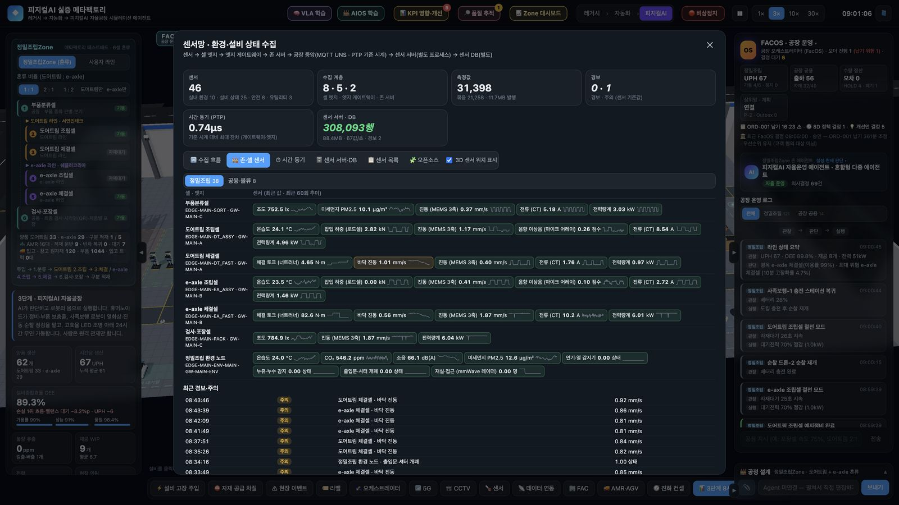

- 「🌡 센서」로 열며 탭 「🔀 수집 흐름」「🏭 존·셀 센서」「⏱ 시간 동기」「🗄 센서 서버·DB」「📋 센서 목록」「🧩 오픈소스」로 구성됨.
- 센서 20종 · 46개 — 셀 6개의 셀 종류별 센서, 정밀조립 환경 노드, 공용 설비·물류 8개. 흐름은 센서 → 셀 엣지 → 엣지 게이트웨이 → 존 서버 → 공장 중앙(MQTT · PTP 기준 시계) → 센서 서버(별도 프로세스) → 센서 DB(별도 SQLite).
- 「3D 센서 위치 표시」를 켜면 3D에 센서 표지가 생기고 정상 초록·주의 노랑·경보 빨강으로 칠해짐.
- 「🗄 센서 서버·DB」 탭에서 센서 DB 값을 CSV로 내려받음. 센서 서버는 앱 서버가 따로 띄우며(단독 실행 `npm run sensor-server`, 기본 127.0.0.1:8793), 데이터 폴더 `sensors/sensors.db`에 원시값 48시간 · 1분 집계 30일을 보관함. 웹 버전에서는 「시뮬레이션」으로 표시됨.
- 발행 토픽: 1초 묶음 `metafactory/sensors/v1/{main|fac}/{셀}` · 센서 메타 `…/birth`(retain).

### 5.9 CCTV

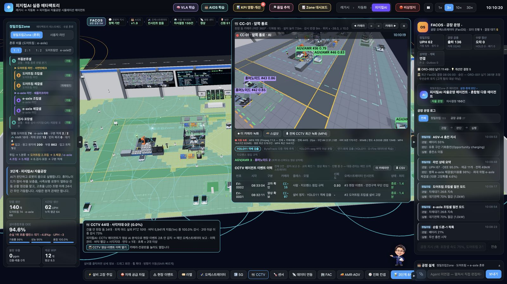

- 「📹 CCTV」를 누르면 바닥에 커버리지 지도(빨강 사각지대 · 연두 1대 · 초록 2대 이상)와 「📹 CCTV 44대 · 사각지대 n곳」 카드(천장 돔 34대 · 트럭 야드 실외 PTZ 10대)가 나옴.
- 「📺 CCTV 영상·이벤트 이력 열기」 또는 3D의 카메라·전광판을 누르면 영상 창이 열림.
- 「◀ 카메라」「카메라 ▶」로 전환, 「⟲」「⟳」로 PTZ 회전.
- 「⏺ 이 카메라 녹화」 (ffmpeg가 있으면 MP4, 없으면 WebM), 「📸 스냅샷」, 「⬇ 전체 CCTV 최근 녹화 (MP4)」. 앱·`npm start`에서는 전체 카메라를 자동 녹화해 데이터 폴더 `cctv/`에 보관함.
- 「CCTV 에이전트 이벤트 이력」 표는 「이 카메라만」으로 거르고 「⬇ CSV」로 내려받음. 피지컬AI 단계에서는 AI 모델 검출 결과(객체 검출 · 추적 · 바닥 이상 · 연기·화재 · 지오펜스 침입)가 영상 위에 표시됨 — 모델 출력 형식을 재현한 시뮬레이션임.

### 5.10 Private 5G

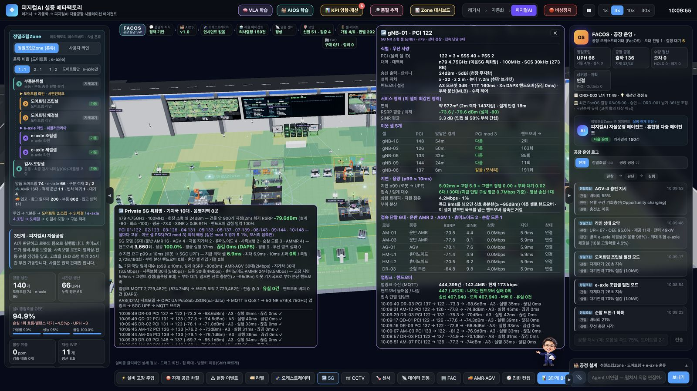

- 「📶 5G」를 누르면 RSRP 커버리지 지도와 「📶 Private 5G 특화망 · 기지국 10대 · 음영지역 n곳」 카드(PCI 배정 · 5G 모뎀 대수 · 핸드오버 · 지연 요구 p99 ≤ 10ms · 최근 핸드오버 로그)가 나옴.
- 3D에서 기지국을 누르면 「식별 · 무선 사양」「서비스 영역」「이웃 셀」「지연 · 용량」「접속 단말」「업링크 · 핸드오버」 정보 창이 열림.

### 5.11 AMR·AGV 관제

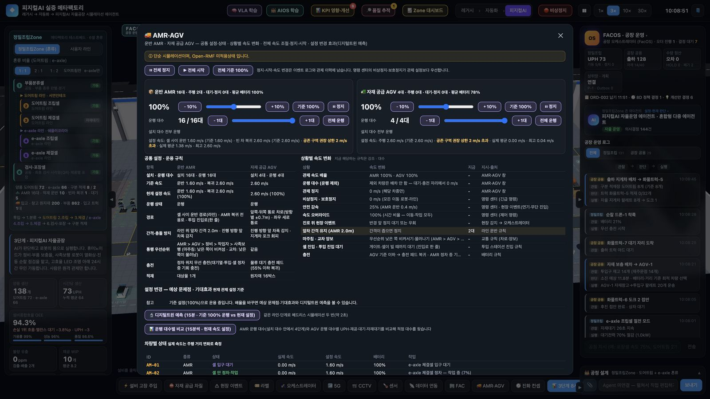

- 「⏸ 전체 정지」「▶ 전체 시작」「전체 기준 100%」로 모든 차량을 한 번에 조작함.
- 차량군(운반 AMR 16대 · 자재 공급 AGV 4대)별로 속도(「－10%」·「＋10%」·「기준 100%」·「⏸ 정지」)와 운행 대수(「－1대」·「＋1대」·「전체 운행」)를 바꿈.
- 「🔬 디지털트윈 예측」은 현재 설정과 기준 100% 운행을 15분 비교하고, 「📊 운행 대수별 비교」는 대수별 결과를 15분씩 비교함.
- 명령 센터의 비상정지·보호정지가 관제 설정보다 우선함.
- ※ 단순 시뮬레이션이며 Open-RMF는 적용되어 있지 않음.

### 5.12 FAC 업무 기록

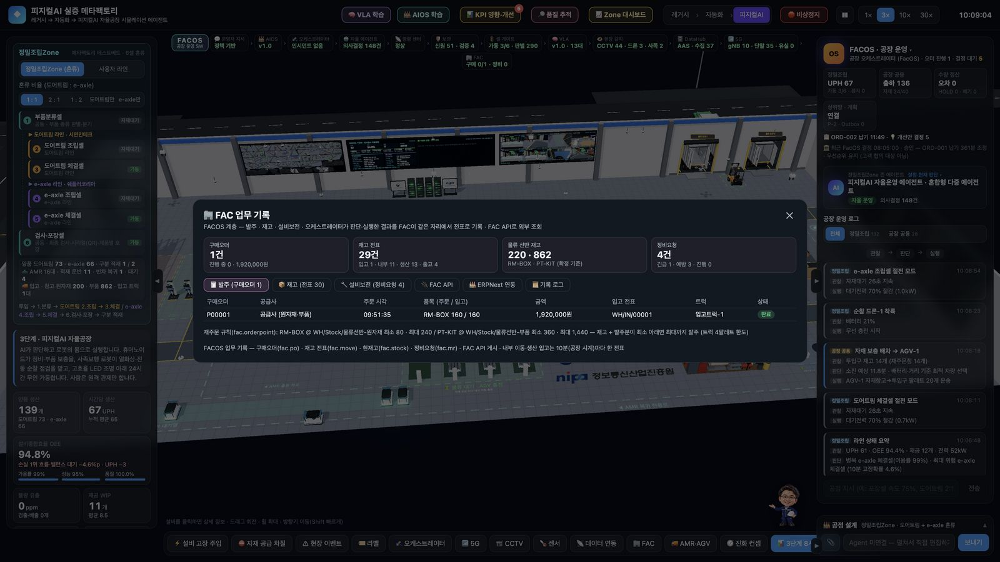

- 탭 「🧾 발주」「📦 재고」「🔧 설비보전」「🔌 FAC API」「🏭 ERPNext 연동」「📜 기록 로그」로 구매오더·재고 전표·정비요청을 확인함.
- 「🔌 FAC API」 탭에 조회 API 목록(`GET /api/fac/status · po · moves · stock · mr · equipment · orderpoints · events`)과 curl 예시가 있음 (읽기 전용, 웹 버전에서는 서버가 없어 사용 불가). 앱 내장 서버는 앱 화면과 curl·MES 같은 프로그램의 요청만 받고, 다른 웹 페이지(브라우저)가 보낸 요청은 거부함(403).

**ERPNext 연동 (선택 · 맥 앱·윈도우 앱·npm start)**

FAC 기록 · 공장 오더 · 품질 기록을 오픈소스 ERP인 ERPNext에 전표로 남김(앱은 REST로 호출만 함).

| FACOS 기록 | ERPNext 문서 |
|---|---|
| 구매오더 · 입고 | Purchase Order · Purchase Receipt |
| 내부 이동 · 생산 입고 | Stock Entry (이동 · Manufacture — BOM 소비 + 완제품) |
| 출고 | Delivery Note (선택: 「출하 전표에 시리얼」) |
| 공장 오더 | Work Order (제품별) |
| 정비요청 | 긴급 = Asset Repair · 예방 = Asset Maintenance Log |
| 출하 전 샘플 재검 | Quality Inspection (OK · NG) |
| 샘플 NG · 처분 | Non Conformance + 처분 판정(MRB) Quality Action · 폐기는 Stock Entry(Material Issue) |
| 체결 전수 검사 NG · 8D | Non Conformance · Quality Action (D0~D8) |

1. 「🏭 ERPNext 연동」 탭에 ERPNext 주소 · API 키 · 비밀 키(회사는 선택)를 넣음.
2. 「연결 시험」 → 「ERPNext 준비」(품목 · 창고 · 거래처 · BOM · 품질 절차 · 중복 방지 필드 `mf_ref` 등을 만듦) → 「연동 켜기」 체크 → 「저장」.

- 문서마다 `mf_ref`(운전 ID:FAC 번호)를 남겨 다시 보내도 한 번만 만들어짐. ERPNext가 꺼져 있으면 대기했다가 다시 보내고, 검증 오류 전표는 건너뛰고 사유를 남김.
- 키는 이 PC 데이터 폴더(`erpnext/config.json`)에만 보관되고 화면·응답에는 나오지 않음.
- ※ **실제 ERPNext 서버로는 확인하지 못했음** — 응답 형식을 흉내 낸 가짜 서버로만 시험함(`tests/erpnext.mjs`).

### 5.13 VLA 학습 · AIOS 학습 (피지컬AI 단계)

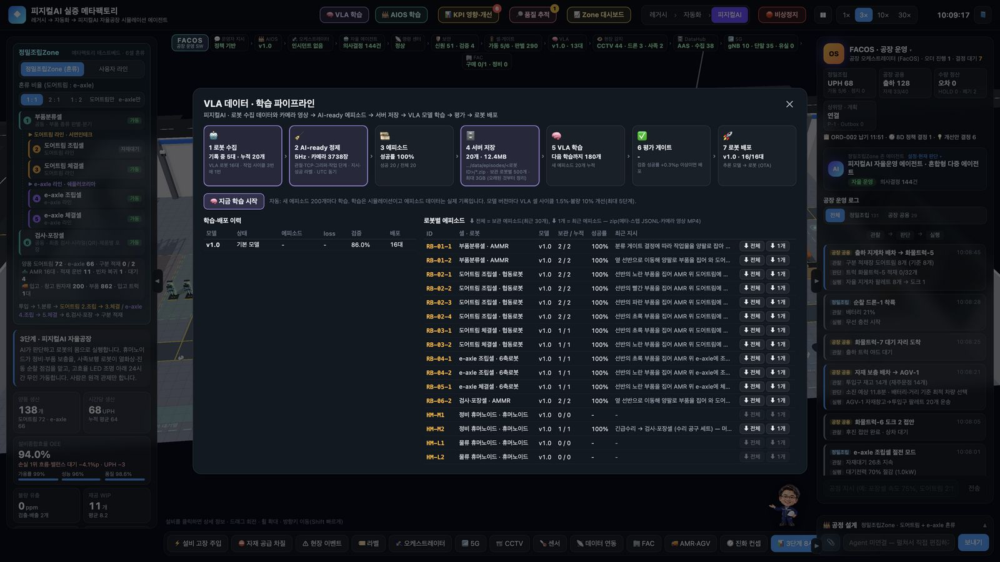

- **(VLA)** 로봇 수집 → AI-ready 정제 → 에피소드 → 서버 저장 → VLA 학습 → 평가 게이트 → 로봇 배포 7단계를 보여 줌. 새 에피소드 200개마다 자동 학습하고 「🧠 지금 학습 시작」으로 바로 시작할 수 있음. 「로봇별 에피소드」 표에서 「⬇ 전체」「⬇ 1개」로 zip(메타 · 스텝 JSONL · 카메라 영상)을 내려받음. 학습은 시뮬레이션이고 에피소드 데이터는 실제 기록임.

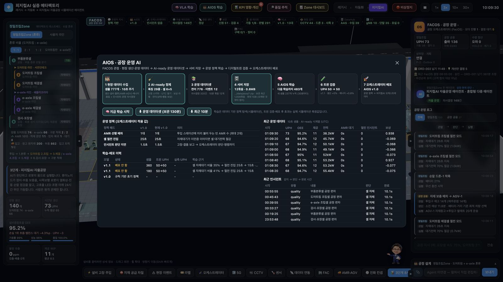

- **(AIOS)** 현장 데이터 수집 → AI-ready 정제 → 운영 데이터셋 → 서버 저장 → AIOS 학습 → 트윈 검증 → 오케스트레이터 배포 흐름. 「🧠 지금 학습 시작」, 「⬇ 운영 데이터셋」「⬇ 최근 10분」. 운영 정책(AMR 선행 배차 · 셀 절전 진입 · 인시던트 판단 지연) 배포는 FacOS 결정을 거침.

### 5.14 FACOS 계층 띠·보안 (피지컬AI 단계)

- 피지컬AI 단계에서 상단에 나타나는 띠는 「운영자 지시 › AIOS › 오케스트레이터 › 자율 에이전트 › 명령 센터 › 보안 › 셀·게이트 › VLA › 현장 감지 › DataHub › 5G › FAC」 순서의 상태 칸임. 칸을 누르면 해당 창이 열리고, 맨 앞 「FACOS 공장 운영 SW」 칸은 띠를 접고 폄.
- 「셀·게이트」 칸은 셀별 진행 결과와 분류·포장 게이트 판별 이력을 보여 줌.

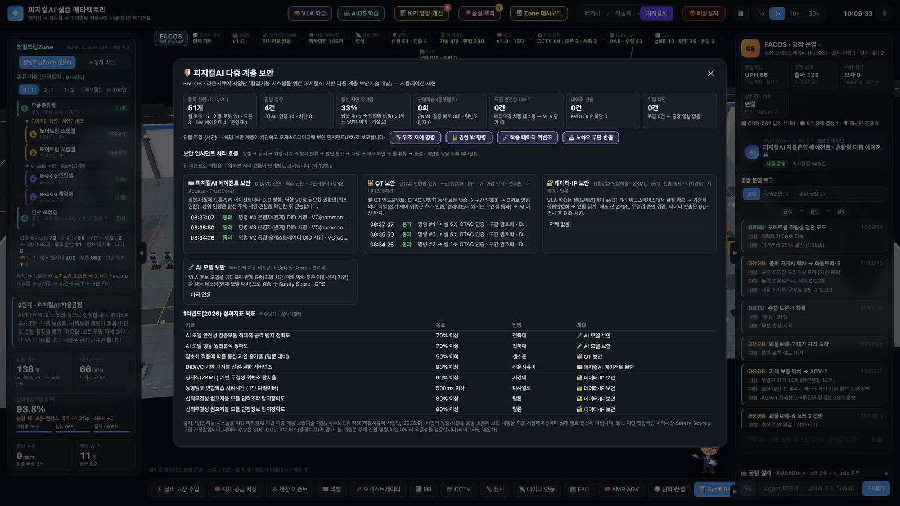

- 「보안」 칸의 「🛡 피지컬AI 다중 계층 보안」에서 위협(「🎭 위조 제어 명령」「🔓 권한 밖 명령」「🧬 학습 데이터 위변조」「📤 노하우 무단 반출」)을 주입하고 처리 흐름을 확인함. 보안 기술 동작을 재현한 시뮬레이션임.

### 5.15 FacOS 계층 · A2A 메시지 · UNS 토픽 트리

오케스트레이터 창의 세 탭. 계층은 공장 오케스트레이터(FacOS) ↔ 정밀조립 존 오케스트레이터(Manufacturing Agent) ↔ 셀 OCS ↔ 엣지이고, 존이 하나라 존 ↔ 존 메시지는 생기지 않음.

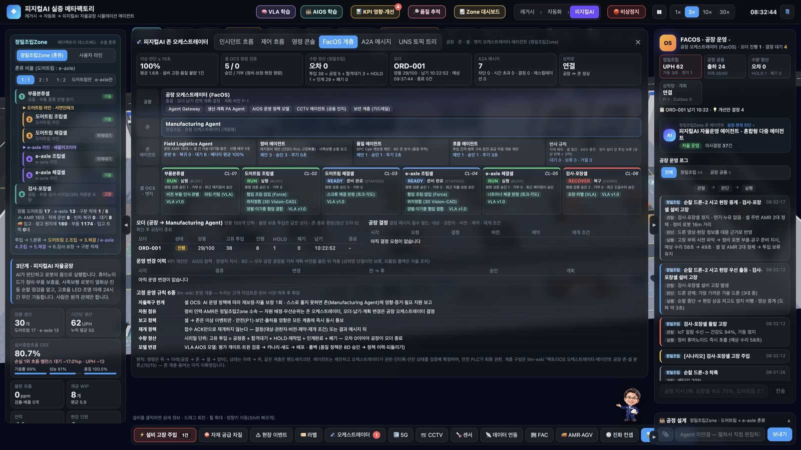

- **「FacOS 계층」**: 위쪽 타일(이상 판단 ≤ 10초 · 셀 OCS 명령 검증 승인/거부 · 수량 정산 · 오더 · A2A 메시지 · 상위망) → 공장(Agent Gateway 등) → 존 에이전트(Field Logistics · 정비 · 품질 · 흐름 · 반사 규칙) → 셀 OCS 6개(상태 · 명령 검증 · 엣지 스킬) → 「오더」 표 · 「공장 결정」 표 · 「운영 변경 이력」 표 · 「고정 운영 규칙 6종」.
  - 오더는 양품 100개 단위로 배정되고, 존의 종료 증빙에서 수량 정산 오차가 0일 때만 공장이 종료함. 수량 정산: 고유 투입 = 공정중 + 합격대기 + HOLD·재작업 + 인계완료 + 폐기.
  - KPI 개선안 적용 · AIOS 정책 배포 · 대화 지시의 계획 변경 · 8D 정책 승인은 모두 공장 결정을 거쳐 계획 버전(P-n)을 올린 뒤 적용됨. 상위망이 끊기면 적용하지 않고 보류 사유를 표시함.

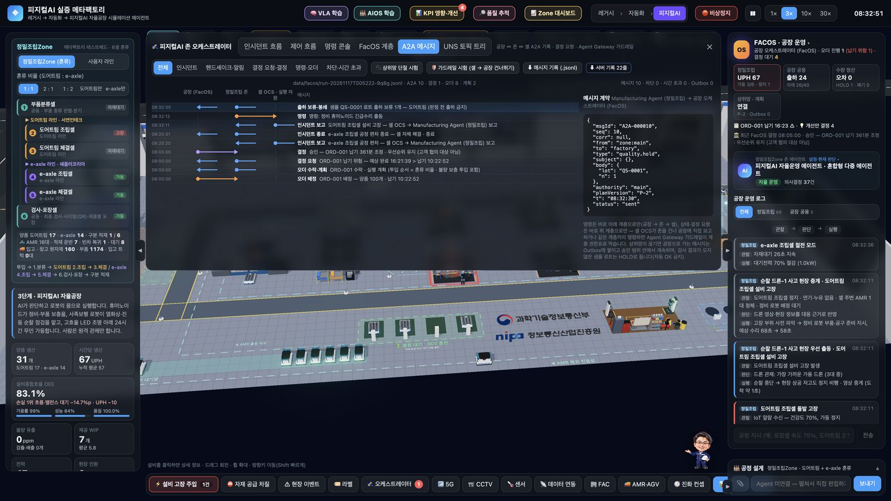

- **「A2A 메시지」**: 공장 (FacOS) · 정밀조립 존 · 셀 OCS·실행 자원 3개 레인의 메시지와 선택한 메시지의 계약(JSON). 필터 「전체 · 인시던트 · 핸드셰이크·알림 · 결정 요청·결정 · 명령·오더 · 차단·시간 초과」.
  - 「🔌 상위망 단절 시험」: 공장 ↔ 존 망을 끊으면 공장으로 가는 메시지가 Outbox에 쌓이고, 복구하면 전달됨.
  - 「🛡 가드레일 시험 (셀 → 공장 건너뛰기)」: 셀 OCS가 존을 건너 공장에 직접 보고하는 메시지를 보내 Agent Gateway가 계층 권한표로 차단하는 것을 보여 줌.
  - 「⬇ 메시지 기록 (.jsonl)」 · 「⬇ 서버 기록」(앱·`npm start` — 데이터 폴더 `facos/<실행 ID>.jsonl`).

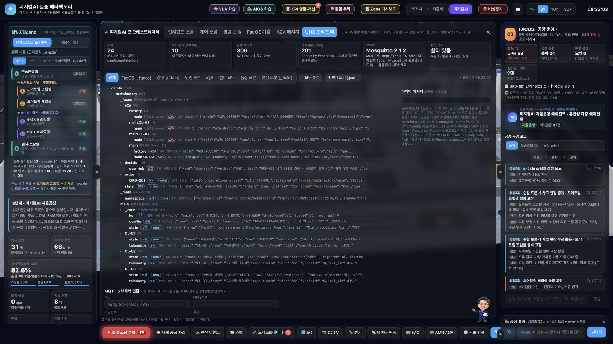

- **「UNS 토픽 트리」**: FacOS 상태·오더·결정·A2A · 존 · 셀 OCS · 명령 4단 · 설비 요약 · Zone KPI · 품질 표본 · 현장 로봇 업링크를 `camtic/metafactory/main/{셀}/…` 트리로 발행함. 상태는 retain으로 값이 바뀔 때만 보냄(Report by Exception).
  - 필터 「전체 · FacOS (_facos) · 상태 (retain) · 명령 4단 · A2A · 설비 요약 · 품질 표본 · 현장 로봇 (_field)」, 「▾ 모두 펼치기」, 「⬇ 현재 트리 (.json)」. 토픽을 누르면 마지막 메시지가 보임.
  - 명령은 같은 Correlation ID로 `cmd → cmd/ack → cmd/exec → cmd/done` 4단을 이음.
  - **브로커**: 내장 MQTT 5 브로커는 Eclipse Mosquitto 2.1.2(포트 1883)이며, 실행 파일이 없거나 시작에 실패하면 aedes(MQTT 3.1.1)로 대신하고 엔진·사유를 타일에 표시함.
  - **「MQTT 5 브로커 연결」**: 공장 밖 MQTT 5 브로커(사내 · 클라우드)에도 같은 메시지를 내보내려면 주소 · 계정 · 비밀번호 · 버전을 넣고 「연결 켜기」 → 「💾 저장 · 연결」.
  - **「Sparkplug B 엣지」**: 엣지 노드 `edge-main`이 셀을 디바이스로 NBIRTH · DBIRTH · DDATA를 내고, 주 호스트가 `main/{셀}/telemetry` · `edge`로 옮기는 상태 표.
  - **「접근 권한 (ACL)」**: 읽기는 모두, 쓰기는 역할별 — `operator`(모든 존 명령 요청) · `zone-main`(자기 존 명령 요청만) · 익명(읽기 전용). 계정 비밀번호는 「보기」로 확인함.
  - **「외부 명령 요청」**: 외부 프로그램이 `camtic/metafactory/main/{셀|_zone}/cmd/request` 로 명령을 요청하면 FacOS 명령 경로(셀 OCS 검증)를 거쳐 명령 4단으로 응답함. 화면에 `mosquitto_pub` 예시가 있음.
  - 웹 버전은 발행 없이 트리만 보여 줌.

### 5.16 현장 대응 팝업 · 사람 진입 추적 (피지컬AI 단계)

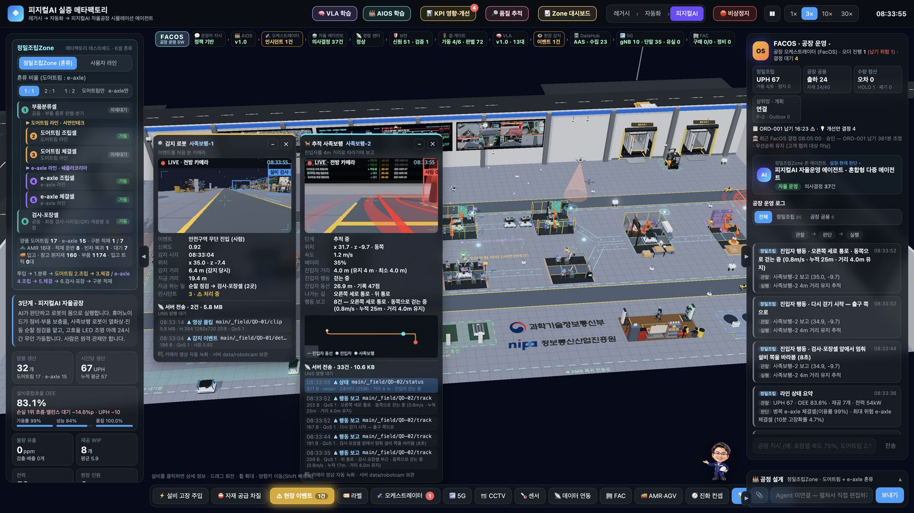

- 현장 이벤트가 감지되면 화면 아래에 「🔍 감지 로봇」(이벤트를 처음 본 카메라 영상) · 「🚑 대응 로봇」(배정된 로봇 · 현장 처리) 창이 뜸. 무단 진입이면 「🐕」 추적 사족보행 창과 진입자 동선 지도가 더 나옴.
- 창마다 이벤트 · 신뢰도 · 감지 시각 · 위치 · 지금 하는 일과 「📡 서버 전송」(감지 이벤트 · 영상 클립 · 배정 응답 · 상태 — UNS 토픽 `main/_field/{자산 ID}/…` 과 크기)이 나옴.
- 해결 8초 뒤 닫히고, 창마다 접기(–) · 닫기(✕)가 있음.
- **사람 진입**: 안전구역에 사람이 들어오면 주변 셀 안전 감속과 함께 가장 가까운 사족보행(배터리 20% 이상)이 4m 거리를 두고 나갈 때까지 따라다니며 10초마다 위치·행동을 보고함. 진입자가 걸어 나가는 출구는 건물 앞쪽 개방면의 2곳(오른쪽 · 왼쪽)임. 5분 안에 나가지 않으면 원격 관제 요원 확인으로 닫음.

### 5.17 물류존 미니로드 AS/RS

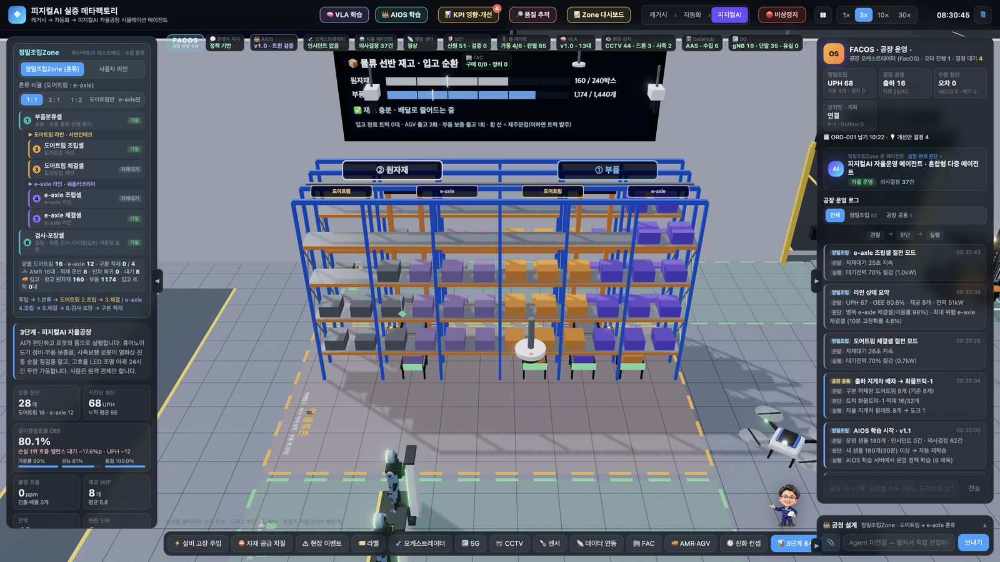

- 물류 확장동의 선반은 **미니로드 AS/RS**(SSI Miniload형 자동창고)임. 두 줄 선반(서쪽 A열 · 동쪽 B열) 사이 통로를 **스태커 크레인**이 오가며 토트를 옮기고, 저장은 **4단**임.
- Zone이 하나라 한 통로 · 한 레일을 반씩 나눠 구간 2개로 두고 크레인을 1대씩 둠.

| 구간 | 보관 품목 | 칸 수 |
|---|---|---|
| 미니로드 ① (북쪽 절반) | 부품 (e-axle 부품 · 도어트림 부품) | 6베이 × 2줄 × 4단 = 48칸 |
| 미니로드 ② (남쪽 절반) | 원자재 (e-axle 원자재 · 도어트림 원자재) | 6베이 × 2줄 × 4단 = 48칸 |

- 두 구간이 맞닿는 끝 베이에서는 두 크레인이 1.2m 넘게 떨어지도록 한쪽(②)이 기다림.
- **입고**: 입고 지게차가 서쪽 면 바닥의 입고 팔레트 받침에 팔레트를 내려놓으면, 크레인이 토트 4개를 하나씩 칸에 넣음.
- **출고 · AGV 자동 적재**: 크레인이 칸에서 토트를 꺼내 동쪽 면 바닥의 출고 이재 컨베이어 끝에 미리 대 둠. AGV가 상차 자리에 서면 신축 롤러가 뻗고 토트가 롤러를 타고 AGV 위로 넘어감 — AGV 상차 2초(휴머노이드 피킹·유인 지게차는 4초).
- **재고 표시**: 칸의 토트는 재고만큼 아래 단부터 차고 품목별로 색이 다름. 열 표지와 「① 부품 / ② 원자재」 표지는 선반 위에 있고, 물류 선반 재고 현황판은 선반 옆 왼쪽 벽에 걸려 있음.
- 크레인 · 토트 이동은 화면 연출이며, 시뮬레이션 결과에는 AGV 상차 시간(2초)만 영향을 줌.

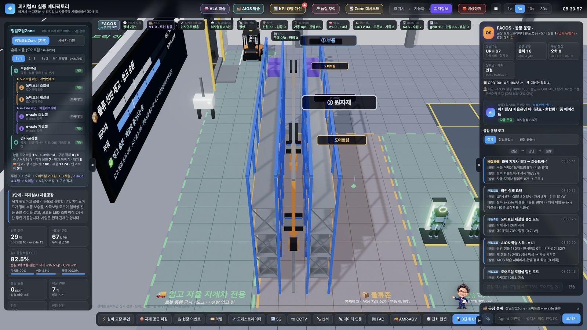

- **입고 · 출하**: 공급사 트럭이 왼쪽 벽 입고 도크에 접안하면 입고 지게차가 팔레트를 내려 선반에 넣고, 재고가 재주문점(원자재 80박스 · 부품 360개) 아래로 내려가면 WMS가 트럭을 발주함. 구분 적재장의 포장 완제품은 출하 지게차가 팔레트(8개) 단위로 뒷벽 출하 도크 2곳의 화물트럭(적재 32개)에 실음.

### 5.18 Zone 대시보드 (실시간 모니터링 · OEE · 파레토 · 관리도 · 산점도)

상단 「📈 Zone 대시보드」로 여는 정밀조립Zone 대시보드임(Zone이 하나라 Zone을 고르는 단추는 없음). 탭 3개로 봄.

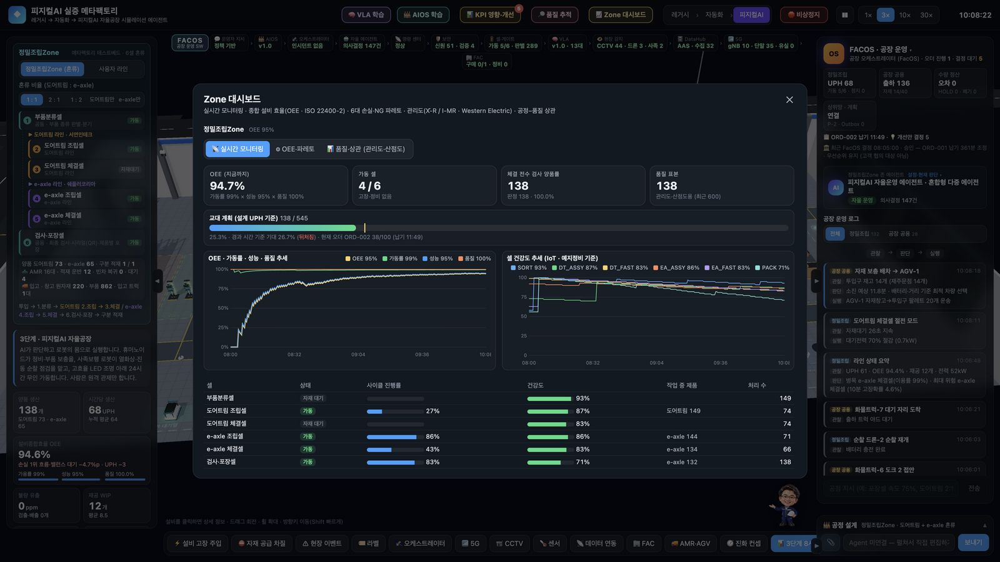

| 탭 | 보는 것 |
|---|---|
| 「📡 실시간 모니터링」 | OEE(지금까지) · 가동 셀 수 · 체결 전수 검사 양품률 · 품질 표본 수 · 교대(8시간) 계획 대비 진행률과 현재 오더 진행도 · OEE·가동률·성능·품질 추세 · 셀 건강도 추세 · 셀별 상태·사이클 진행률·건강도·작업 중 제품·처리 수 |
| 「⚙ OEE·파레토」 | 가동률 A · 성능 P · 품질 Q · OEE, 손실 시간 파레토(6대 손실 · 누적 % 선 · 80% 기준선), 「NG 유형」 파레토, 셀별 OEE와 시간 구성 막대 |
| 「📊 품질·상관 (관리도·산점도)」 | 품질 특성(도어트림 체결 토크·각도 · e-axle 체결 토크·각도)을 고르면 관리도(X̄-R / I-MR) · UCL/CL/LCL · Western Electric 규칙 위반점 · 공정능력 Cp·Cpk, 공정 변수 × 품질 특성 상관계수 표 · 산점도(양품 · NG · 회귀선) — 표의 행을 누르면 산점도가 바뀜 |

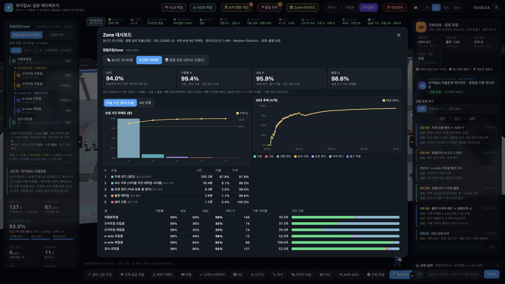

- **OEE 계산 (ISO 22400-2)**: OEE = 가동률 × 성능 × 품질. 계획 정비(예지정비·교정)는 계획 시간에서 뺌. 라인 값은 왼쪽 KPI의 OEE와 같은 값임.
- **자동 해석**: 관리도와 산점도 아래 「🧭 해석」 상자가 지금 데이터로 판정·근거·권장 조치를 문장으로 보여 줌. 데이터에서 규칙으로 뽑은 문장이며, 상관은 원인을 증명하지 않음 — 상관이 큰 변수는 「🔎 품질 추적」 계보·8D 분석과 함께 확인함.
- **Grafana에서 보기 (앱 전용)**: 설비 대시보드(5.7)가 켜져 있으면 탭 줄에 「📈 Grafana에서 보기」가 나오고, 누르면 Grafana의 「정밀조립Zone 운영 분석」 대시보드가 열림.

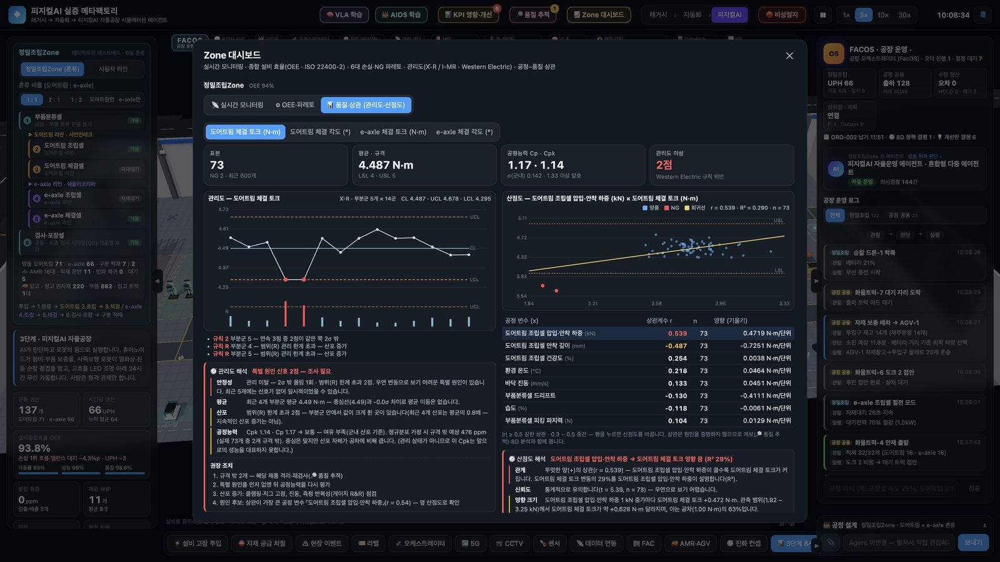

### 5.19 서열 키팅 · 셀 작업 · 작업 시간

**서열 키팅 · 라인사이드 칸반**

혼류 라인의 부품 공급을 두 갈래로 나눔. 대당 사양이 바뀌는 부품은 생산 순서대로 한 대분씩 키트(제품마다 부품 4개)로 담아 AMR에 함께 실어 보내고(서열 키팅), 공용 부품은 조립·체결셀 선반에 두고 투빈 칸반으로 채움.

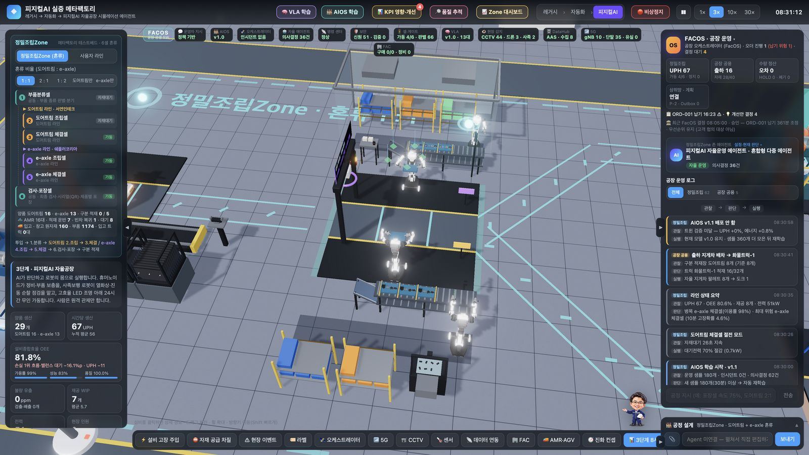

| 구성 | 하는 일 |
|---|---|
| 키팅 구역 2곳 (부품분류셀 양옆 — 도어트림 쪽 · e-axle 쪽) | 흐름 랙 3대(바깥 통로 쪽 보충 · 셀 쪽 꺼냄, 도어트림 셋째는 플렉시블 피더) → 피킹 로봇(피지컬AI AMMR `RB-01-K1`·`K2` · 자동화 레일 위 협동로봇 · 레거시 작업자) → 검증대(카메라 + 저울) → 키트 컨베이어 서열 버퍼(제품마다 3개) |
| 개봉대 · 클린 부스 (e-axle 쪽) | 포장째 보관한 베어링·오일씰 개봉 · 로트 스캐너 · 커튼과 FFU |
| AMR 키트 포켓 | AMR 앞뒤 끝 — 부품분류셀의 그 제품 쪽 로봇 1대가 버퍼 맨 앞 트레이의 부품 4개를 하나씩 넣음. 빈 트레이는 회수 슈트 → 컨베이어 아래 회수 레인으로 |
| 라인사이드 투빈 | 조립·체결셀 선반의 공용 부품 — 설비 상세 창 「🧰 부품 공급 · 라인사이드 칸반」에 재고 표시 |

- 단계별 차이(① 범용 파지 ② 빈 피킹 ③ 키트 검증 AI ④ 로트 추적 ⑤ 개봉·청정 ⑥ 결품·막힘 예측)와 센서 값은 부품분류셀 상세 창의 서열 키팅 항목에 나옴.

**셀이 하는 작업**

| 셀 | 작업 | 기본 로봇 |
|---|---|---|
| 1. 부품분류셀 | 게이트에서 제품 판별 → 그 제품 쪽 로봇 1대가 키트를 AMR 키트 포켓에 옮김 → 제품별 라인으로 분기 | 피지컬AI AMMR 2대 · 레거시·자동화 협동로봇 2대 |
| 2. 도어트림 조립셀 | 변종 부품 조립 · 클립 압입 | 협동로봇 4대 |
| 3. 도어트림 체결셀 | 자동 공급 스크류 드라이버 체결·토크 판정 → 비전 카메라 나사 확인 | 협동로봇 2대 |
| 4. e-axle 조립셀 | 베어링·오일씰 서보 압입 · 기어축 · 로터 삽입 · AMR 도킹 클램프 | 6축 2대 (안전 펜스) |
| 5. e-axle 체결셀 | 2스핀들 서보 너트러너 플랜지 볼트 체결 → EOL 누설·절연 시험 | 6축 1대 (안전 펜스) |
| 6. 검사·포장셀 | 최종 외관·라벨 검사 → 시리얼·QR 라벨 → 제품별 상자 포장 | 도어트림 쪽: 피지컬AI AMMR · 자동화 협동로봇 · 레거시 작업자 / e-axle 쪽: 고가반 6축 |

- **검사·포장셀**: 그 제품 쪽 로봇 1대만 포장함. ① 접힌 상자를 집어 포장대에 폄 → ② AMR 위 제품을 상자에 넣음 → ③ 뚜껑을 덮음 → ④ 프린터의 QR 라벨을 붙임 → ⑤ 닫힌 상자를 AMR 지그에 다시 실음. 출구 문형의 카메라가 외관 검사·QR 판독을 함.
- **자재 투입**: 자재 투입 로봇셀이 원자재를 AMR 위에 내려놓은 뒤에 투입됨. AMR(16대)은 대상물을 싣고 셀 중앙에 정차하며, 셀이 작업 중이면 셀 밖에서 기다림. 레거시 단계는 고정 컨베이어임.
- **구분 적재장**: 포장 상자를 제품별 구역에 쌓음 — 도어트림 트레이 박스 24칸 · e-axle 폴딩 크레이트 12칸(화면에 보이는 칸 수).

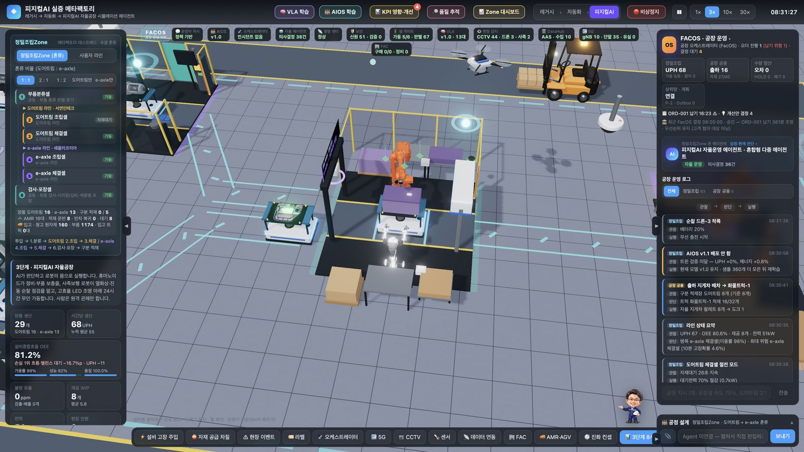

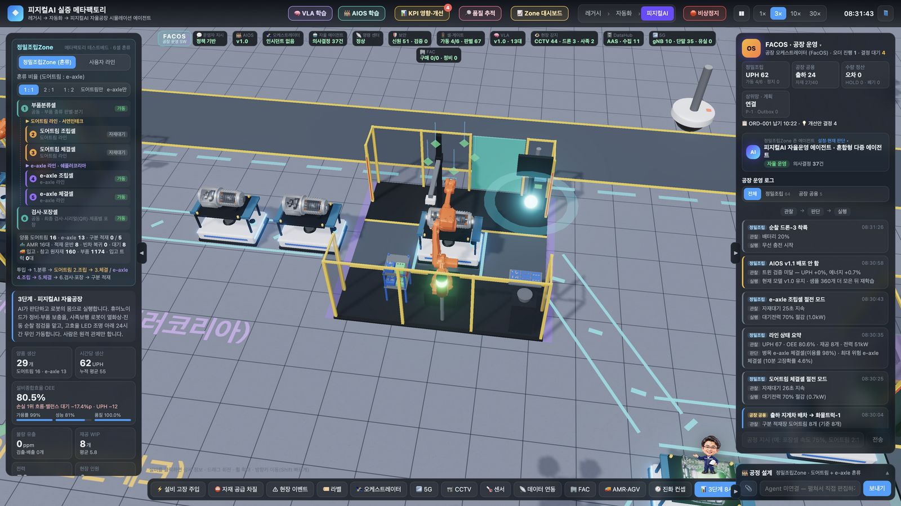

**셀 실제 작업 시간**

셀 사이클은 셀 작업 요소를 실제 공장 기준으로 더한 값임. 공정 설계에서 바꾼 기준 사이클은 자동화 기준 시간 대비 비율로 모든 단계에 같이 적용됨(범위 2~300초).

| 정밀조립 셀 (초) | 레거시 | 자동화 | 피지컬AI |
|---|---|---|---|
| 부품분류 | 18 | 25 | 30 |
| 도어트림 조립 | 35 | 26 | 37 |
| 도어트림 체결 | 21 | 19 | 26 |
| e-axle 조립 | 77 | 51 | 52 |
| e-axle 체결 + EOL 시험 | 198 | 106 | 108 |
| 검사·포장 (도어트림 / e-axle) | 35 / 70 | 37 / 53 | 50 / 55 |

- 피지컬AI는 VLA 인식·계획 시간만큼 자동화보다 조금 느리지만 티칭 없이 변종·유연물을 다룸.
- e-axle 체결셀이 병목이라 1:1 혼류의 시간당 생산은 약 55~59개임(트윈 비교 기준).

### 5.20 구간별 성능 표시

- 3D 화면에서 **P** 키를 누르면 화면 위쪽에 fps · 프레임 간격 · CPU 시간과 구간별(시뮬레이션 진행 · 3D 동작 갱신 · 패널·UI · 에피소드 기록 · 객체 위치 계산 · 전광판 · 녹화 · 메인 화면 렌더 · 라벨) 평균 · p95 · 그리기 호출 수가 나옴. 꺼져 있을 때는 재지 않음.
- `npm run perf` 는 5개 장면(레거시 · 자동화 · 피지컬AI · 피지컬AI + 로봇 정보 창 · 피지컬AI + CCTV 영상 창)을 자동으로 재어 `outputs/perf/` 에 남김(개발자용).

### 5.21 안내 아바타 토리

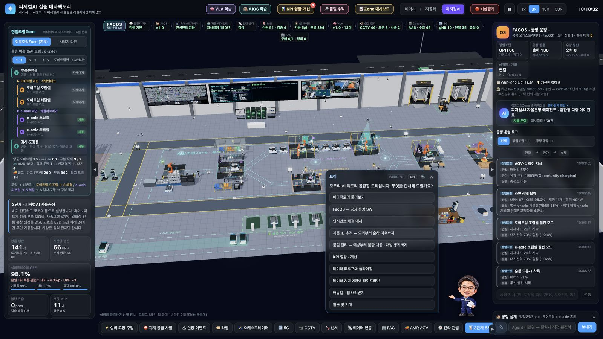

- **토리**: 화면 오른쪽 아래에 공장장 캐릭터(모두의 AI 팩토리 공장장 토리)가 서서 말풍선과 음성으로 안내함. 처음 접속하면 인사한 뒤 「메타팩토리 둘러보기」를 시작하고, 「✕」로 접은 뒤에는 작은 공장장을 눌러 주제를 고름.
- **안내 주제** (메뉴 순서):

| 주제 | 내용 |
|---|---|
| 「메타팩토리 둘러보기」 | 정밀조립Zone · 단계 버튼 · 오른쪽 패널 · 위·아래 버튼 · 로봇 정보 창을 차례로 강조하며 소개 |
| 「FacOS — 공장 운영 SW」 | 계층 · 오더 · 결정 요청 · 가드레일 시험 · 상위망 단절/복구를 오케스트레이터 탭을 열어 설명 |
| 「인시던트 해결 예시」 | 토리가 실제로 현장 이벤트를 일으키고 감지 → 보고·판단 → 출동 → 해결 과정을 읽어 줌 |
| 「제품 ID 추적 — 오더부터 출하 이후까지」 | 오더 → 투입(WIP ID) → 셀별 이력 → 시리얼 발행 → 팔레트·출하 → EPCIS 조회 |
| 「품질 관리 — 예방부터 불량 대응 · 재발 방지까지」 | 예방 → 전수 검사 → 출하 전 샘플 재검 → 불량 대응 → AI 원인 분석 → 8D → 모니터링 |
| 「KPI 영향 · 개선」 | 손실 분석 → 개선 제안 → 디지털트윈 검증 → 적용 · 보류 · 되돌리기 |
| 「데이터 폐루프와 플라이휠」 | 수집 → 엣지 → 서버·연동 → AI 학습 → 모니터링 → 현장 제어, 그리고 운영 → 데이터 → 학습 → 배포의 고리 |
| 「데이터 & 제어명령 파이프라인」 | 데이터가 올라가고 제어 명령이 같은 길로 내려가는 경로 |
| 「매뉴얼 · 앱 내려받기」 | Claude API 키 안내와 📘 사용자 가이드 |
| 「활용 및 기대」 | 실증장 · 데이터 공장 · 교육장으로서의 활용과 기대 효과 |

- **버튼**: 「◀ 이전」「다음 ▶」「주제」, 첫 인사의 「다음에」「둘러보기 시작 ▶」, 주제 끝의 「마치기」. 머리줄의 「EN」은 영어 안내로 바꾸고(고른 언어는 기억), 「🔊」는 음성만 끄며, 「✕」는 접음.
- **자동 넘김**: 말이 끝난 뒤 1초 동안 「다음」을 누르지 않으면 다음 단계로 넘어가고, 주제가 끝나면 메뉴 순서의 다음 주제로 이어짐. 「활용 및 기대」까지 끝나면 5초 뒤 「메타팩토리 둘러보기」부터 다시 되풀이하며, 「마치기」를 누르면 멈춤. 주제 메뉴에서는 기다림.
- **토리가 화면을 움직임**: 주제에 따라 카메라를 옮기고 관련 창을 열며, 단계가 바뀌면 토리가 연 창은 닫힘. 인시던트 예시 · 품질 관리 · KPI 주제에서는 토리가 현장 이벤트 · 공정 편차를 일으키거나 배속을 바꿨다가 주제가 끝나면 원래대로 되돌림. 8D의 정책 반영 같은 결정은 토리가 누르지 않음.
- **음성**: 미리 녹음한 한국어 음성(`assets/tori/voice/`)을 재생하고, 녹음을 틀 수 없을 때만 운영체제 내장 남성 음성으로 읽음(남성 음성이 없으면 목소리가 바뀌지 않게 소리 없이 말풍선만 표시). 웹 브라우저는 화면을 처음 누를 때부터 소리가 남(맥·윈도우 앱은 첫 인사부터).
- 토리 그림은 메인 3D 화면과 따로 그려 공장 화면 속도와 무관함(WebGPU, 쓸 수 없는 환경은 WebGL — 머리줄에 방식 표시).

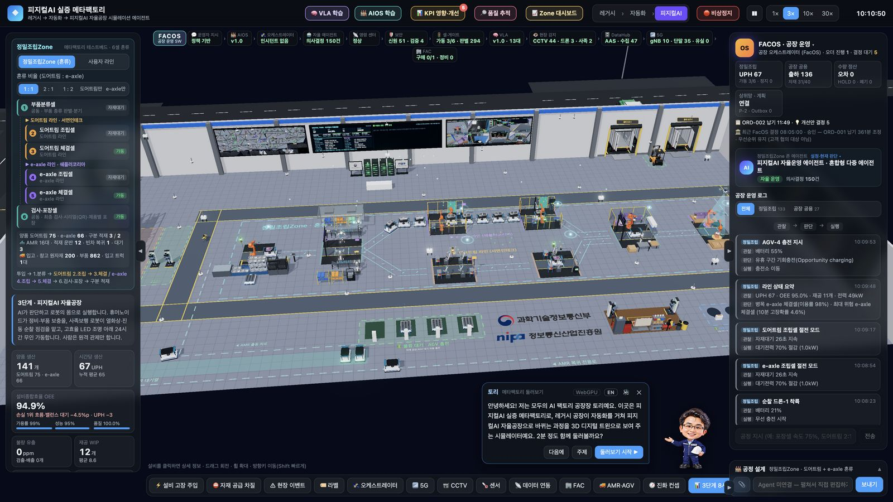

---

## 6. 파일 저장·내보내기 요약

| 데이터 | 저장하는 곳 | 형식·파일명 |
|---|---|---|
| 자산 데이터 (AAS) | 데이터 연동 「💾 저장」 | JSON·XML·RDF (v3.1/v3.0) |
| 표 데이터 | 데이터 연동 「CSV」 | CSV |
| 공장 구성 | 데이터 연동 「AutomationML」 | .aml |
| 로봇별 누적 데이터 | 로봇 정보 창 「💾 누적 데이터 저장 (AAS)」 | AASX·JSON·XML·RDF |
| 통신 패킷 | 데이터 연동·설비 상세 「💾 .pcap 저장」 | .pcap |
| 품질 통신·리포트 | 품질 추적 「📡 보고·통신」 | `QualityComm_<사례>.pcap`, `QualityReport_<사례>.json` |
| 불량 원인 분석 데이터 | 품질 추적 「✖ 불량 분석」 | `RCA_<사례>_<시리얼>.zip`, `RCA_dataset_….zip` |
| KPI 리포트 | KPI 영향·개선 「📄 리포트 저장 (.md)」 | .md |
| CCTV 영상·이력 | CCTV 영상 창 | MP4(또는 WebM)·스냅샷, `CCTV_이벤트이력_<실행 ID>.csv` |
| A2A 메시지 | 오케스트레이터 「A2A 메시지」 | `A2A_messages_<번호>.jsonl` |
| UNS 토픽 트리 | 오케스트레이터 「UNS 토픽 트리」 | `UNS_tree_<초>s.json` |
| VLA 에피소드 | VLA 학습 「로봇별 에피소드」 | 로봇별 .zip |
| AIOS 운영 데이터셋 | AIOS 학습 | .zip |
| 센서 값 | 센서 「🗄 센서 서버·DB」 | CSV |

---

## 7. 서버·데이터 관리

### 7.1 서버와 포트

| 서버 | 기본 포트 | 비고 |
|---|---|---|
| 앱 서버 (맥·윈도우 앱) | 127.0.0.1:47615 | 쓰이고 있으면 빈 포트. 고정 포트여야 AAS 안의 영상 링크가 재실행 후에도 열림 |
| 앱 서버 (`npm start`) | 8765 | `PORT` 로 변경 |
| 내장 MQTT 5 브로커 (Mosquitto) | 127.0.0.1:1883 | `MQTT_HOST`·`MQTT_PORT` 로 변경, 외부 PC 공개는 `MQTT_HOST=0.0.0.0`, 외부 브로커 연동은 UNS 탭 또는 `MQTT_BRIDGE_URL`. 엔진 선택 `MQTT_ENGINE`(auto · mosquitto · aedes) |
| 센서 서버 | 자동 (단독 실행 8793) | `npm run sensor-server` |
| RCA 서버 (더미) | 앱 서버 내장 (단독 실행 8775) | `npm run rca-server` |
| 설비 대시보드 (선택 · Docker) | Grafana 3320 · InfluxDB 8206 | 5.7절 |

- 내장 서버는 127.0.0.1에만 열리고, 이 앱 화면이 보낸 요청과 브라우저가 아닌 프로그램(curl · MES)의 요청만 받음. 다른 웹 페이지가 보낸 요청은 403으로 거부함.
- 상위 meta-factory 앱(브로커 1885 · 센서 서버 8791 · Grafana 3300 · InfluxDB 8186)과 포트가 달라 두 앱을 같이 켤 수 있음.

### 7.2 데이터 폴더

| 실행 형태 | 위치 |
|---|---|
| 맥 앱 | `~/Library/Application Support/Jin-3D/data/` |
| 윈도우 앱 | `%APPDATA%\Jin-3D\data\` |
| `npm start` | 프로젝트의 `data/` |

- 하위 폴더 — `episodes/`(VLA 에피소드), `aios/`, `cctv/`, `robotcam/`, `sensors/sensors.db`(센서 DB), `epcis/`(EPCIS 이벤트), `facos/`(FacOS 기록), `uns/`(접근 권한 · 브로커 설정), `erpnext/`, `monitoring/`.
- 보관 한도는 환경변수로 바꿈 — `JIN3D_EPISODE_KEEP`(로봇마다 500개) · `JIN3D_EPISODE_MAX_MB`(3GB), `JIN3D_AIOS_KEEP`(1,008묶음) · `JIN3D_AIOS_MAX_MB`(1GB), `JIN3D_CCTV_KEEP` · `JIN3D_ROBOTCAM_KEEP`(576구간), `JIN3D_MP4_KEEP`(144구간), `JIN3D_CCTV_MAX_MB`(4GB) · `JIN3D_ROBOTCAM_MAX_MB`(8GB). FacOS 기록은 최근 50개 실행(`FACOS_KEEP_RUNS`).
- 데이터 폴더 위치는 `JIN3D_DATA_DIR` 로 바꿈.

### 7.3 영상 변환 (ffmpeg)

- ffmpeg가 설치되어 있으면 녹화 영상을 MP4(H.264)로 변환함. 없으면 WebM으로만 저장함.
- **(맥)** `brew install ffmpeg`. 찾는 순서는 `FFMPEG_PATH` → Homebrew → `~/.local/bin` → PATH.
- **(윈도우)** `winget install Gyan.FFmpeg`. 찾는 순서는 `FFMPEG_PATH` → winget 설치 위치 → `C:\ffmpeg\bin` → `Program Files\ffmpeg\bin` → PATH. 설치 후 앱을 다시 켜야 반영됨.

---

## 8. 문제 해결

| 증상 | 원인 | 조치 |
|---|---|---|
| 다른 Mac에서 앱이 열리지 않음 | ad-hoc 서명 | Finder에서 우클릭 → 열기 (처음 한 번) |
| 「내장 서버를 시작하지 못했습니다.」 | 서버 시작 실패 | 앱 종료 후 재실행, 이전 앱 프로세스가 남아 있으면 종료 |
| 브로커가 1883이 아닌 포트로 표시됨 | 1883을 다른 프로그램이 사용 중 | 그대로 써도 됨. 외부 구독 프로그램은 표시된 포트로 접속 |
| UNS 탭 브로커가 aedes로 표시됨 | Mosquitto 실행 파일이 없거나 시작 실패 | 타일의 사유 확인. MQTT 3.1.1로 계속 동작함 |
| 3D 화면이 멈추거나 「3D 화면 복구 중…」 | 그래픽 컨텍스트 끊김 | 자동 복구를 기다림. 안 되면 메뉴 보기 › 「시뮬레이션 다시 불러오기」 |
| 대화 입력창이 비활성 | 엔진이 정책 기반이거나 레거시 단계 | 존 에이전트 설정에서 「대화 기반」 선택, 자동화·피지컬AI 단계 사용 |
| 자연어 지시가 해석되지 않음 | Agent 미연결 (내장 해석기만 동작) | 1.5절(앱) · 1.4절(`npm start`) · 1.6절(웹)로 연결 |
| 공정 설계에서 자연어 요청이 안 됨 | Agent 미연결 또는 웹 버전 | 직접 편집하거나 앱·`npm start`에서 키 설정 |
| VLA·AIOS·현장 이벤트 버튼이 안 보임 | 피지컬AI 전용 기능 | 상단에서 「피지컬AI」 선택 |
| 상단에 「📘」가 안 보임 | `docs/USER_GUIDE.pdf` 가 없음 | `npm run guide:pdf` 로 만듦 |
| 영상이 WebM으로만 저장됨 | ffmpeg 미설치 또는 웹 버전 | ffmpeg 설치(7.3절) 후 앱 재실행 |
| 「대시보드 켜기」가 실패함 | Docker가 꺼져 있거나 없음 | Docker Desktop 실행 또는 Colima 설치 (5.7절) |
| (윈도우) 「Windows의 PC 보호」 창이 뜸 | 코드 서명 인증서 없음 | 「추가 정보」 → 「실행」 (처음 한 번, 1.3절) |
| 설정 창에 「예전에 저장한 키를 읽지 못했습니다」 | 앱 이름 변경 전(Jin-3D)에 저장한 키라 키체인 항목 이름이 다름 | ⚙ 설정에서 키를 다시 입력해 저장함 |
| (윈도우) exe를 실행하면 바로 꺼지거나 DLL 오류 | `피지컬AI 실증 메타팩토리.exe` 만 따로 복사함 | `피지컬AI 실증 메타팩토리-win32-x64` 폴더를 통째로 둠 |
| `index.html` 을 열었더니 빈 화면 | ES 모듈은 파일로 직접 실행 불가 | `npm start` 후 http://localhost:8765 접속 |

---

## [부록 A] 첫 30분 실습 순서

1. 피지컬AI 단계(처음 화면)에서 3×로 5분 재생 — 왼쪽 KPI와 오른쪽 운영 로그 확인.
2. 「⚡ 설비 고장 주입」 → 오케스트레이터 「인시던트 흐름」에서 처리 과정 확인.
3. 「⚠ 현장 이벤트」 → 화면 아래 현장 대응 팝업과 CCTV 영상 창에서 감지·대응 확인.
4. 「⛔ 자재 공급 차질」 → 운영 로그에서 에이전트 대응 확인.
5. 「📊 KPI 영향·개선」 → 개선 제안의 트윈 검증 결과 확인 → 「✅ 적용」 → 오케스트레이터 「FacOS 계층」의 운영 변경 이력 확인.
6. 「🔎 품질 추적」 → 「🏷 시리얼·출하」에서 제품의 QR 코드·공정 이력 확인 → 불량 사례가 있으면 AI 원인 순위·8D 흐름 확인.
7. 「📈 Zone 대시보드」 → OEE·파레토와 관리도 확인.
8. 「📡 데이터 연동」 → 「💾 저장」에서 AAS JSON 저장.
9. 「자동화」 · 「레거시」로 전환해 같은 화면을 비교하고, 「📊 3단계 8시간 비교」로 단계별 성과 확인.

## [부록 B] 용어

| 용어 | 뜻 |
|---|---|
| UPH | 시간당 생산량 (Units Per Hour) |
| OEE | 설비종합효율 = 가동률 × 성능 × 품질 |
| WIP | 재공 — 공정 안에 머무는 미완성 제품 수 |
| RUL | 잔여수명 (Remaining Useful Life) |
| AMR · AGV · AMMR | 자율이동로봇 · 무인운반차 · 팔 달린 자율이동로봇 |
| VLA | 시각·언어·동작 통합 로봇 AI 모델 (Vision-Language-Action) |
| AIOS | 공장 운영 정책을 학습하는 운영 AI |
| FACOS · FacOS | 공장 → 존 → 셀 → 엣지 계층의 공장 운영 소프트웨어 · 그 공장 오케스트레이터 |
| 셀 OCS | 셀마다 명령을 권한·인터록·안전 상태로 검증하는 셀 제어기 |
| A2A | 에이전트 간(공장 ↔ 존 ↔ 셀) 메시지 |
| UNS | ISA-95 계층을 따른 통합 네임스페이스(MQTT 토픽 트리) |
| AAS · AASX | 자산관리셸(Asset Administration Shell) · 그 패키지 파일 |
| OPC UA PubSub · MQTT | 산업용 데이터 발행 규격 · 경량 메시지 전송 프로토콜 |
| EPCIS · SSCC | GS1 제품 이벤트 기록 표준 · 물류 단위(팔레트) 식별 코드 |
| WIP ID · 시리얼 | 투입 때 붙는 공정 중 ID · 최종 검사 합격 때 발행하는 제품 고유 ID |
| MRB | 부적합품 처분 판정 (재작업 · 폐기) |
| pcap | 통신 패킷 기록 파일 (Wireshark로 열람) |
| RCA · 8D | 불량 근본 원인 분석 · 8단계 품질 문제 해결 절차 |
| 서열 키팅 · 투빈 칸반 | 생산 순서대로 한 대분 부품을 담아 보내는 공급 방식 · 상자 2개로 보충 시점을 알리는 공급 방식 |
| 미니로드 AS/RS · 스태커 크레인 | 두 줄 선반 사이 통로를 크레인이 오가며 토트(소형 상자)를 넣고 꺼내는 자동창고 · 그 크레인 |
| 디지털트윈 검증 | 개선안을 같은 조건의 가상 공장에서 먼저 돌려 효과를 확인하는 것 |
